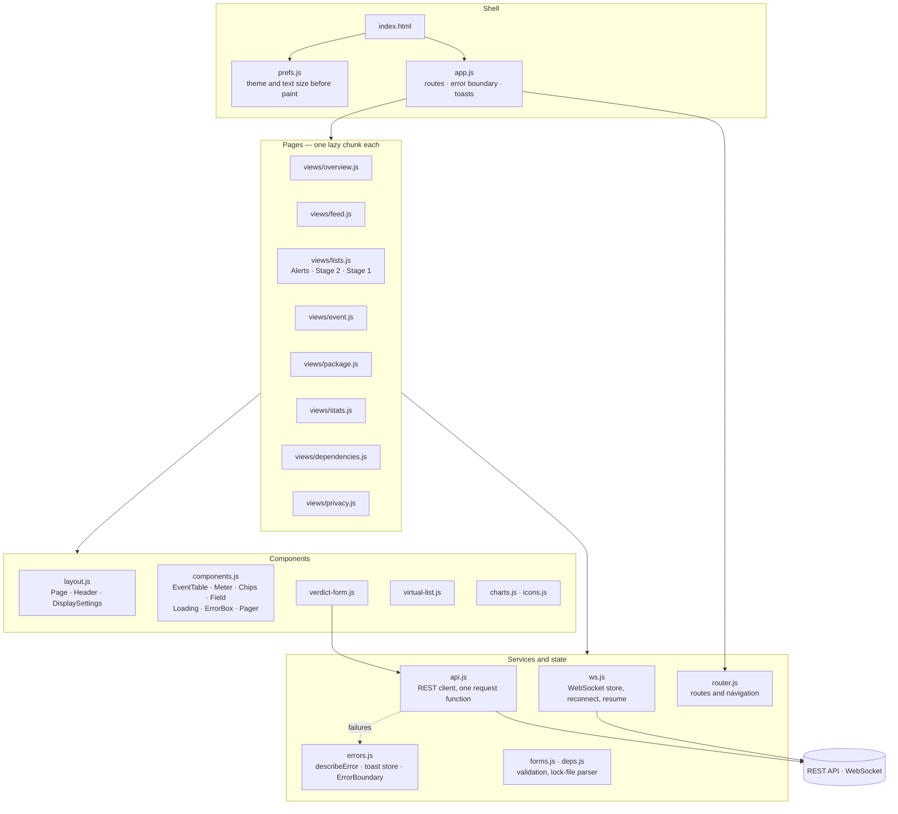
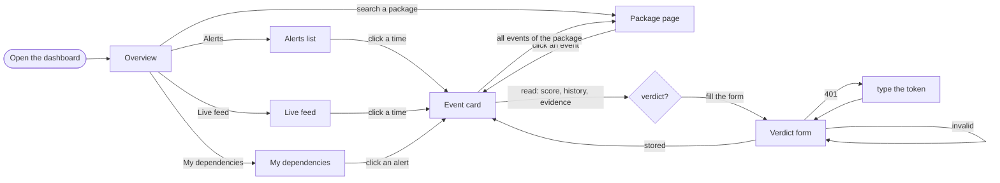

# npm Publication Monitor — front-end

This branch holds the application (the dashboard does not run without its server) and, of the
project documents, only those of the front-end criterion. The whole project is on the branch [main](https://github.com/Krivetka/npm-publication-monitor/tree/main).

The dashboard of the npm Publication Monitor: a single-page application for an analyst who
reviews alerts and for a consumer who checks the packages they depend on.

| | |
|---|---|
| Where the criterion is implemented | `src/web/static/` |
| Framework | Preact 11 with htm (JSX-like templates without a compile step) |
| Bundler | esbuild — `npm run build:web`, output in `src/web/static/dist/` |
| Tests | `test/client-*.test.ts` (unit and component), `test/e2e/` (browser) |
| How to run | short form below, the full form in [Running](#running) |
| API the client uses | [documentation/api/](documentation/api/README.md) |
| Responsive layout, design system | [documentation/adaptive-ui/](documentation/adaptive-ui/README.md) |

```sh
docker compose -f compose.dev.yml up -d && cp .env.example .env
npm ci && npm run migrate && npm run db:seed
echo "ANALYST_TOKEN=$(openssl rand -hex 16)" >> .env   # needed to store a verdict; read it back with: grep ANALYST_TOKEN .env
npm run build:web                              # production bundle (optional in development)
node --env-file=.env src/web/main.ts           # http://127.0.0.1:8090/npm/
```

## Architecture



**Approach: component-based, with small stores instead of a state library.** A page is a
function component that asks a service for data and passes it to presentational components.
Components know nothing about HTTP; services know nothing about markup.

| Layer | Files | Rule |
|---|---|---|
| Pages (containers) | `views/*.js` | one per route; own the data of the page (`useAsync`), compose components. The statistics page reuses two blocks of the overview page |
| Components | `components.js`, `layout.js`, `verdict-form.js`, `virtual-list.js`, `charts.js`, `icons.js` | render props and make no request. Two exceptions: `layout.js` holds the route store and reads the state of the stream for the header; `verdict-form.js` calls a service, which it takes as a prop |
| Services | `api.js`, `ws.js` | the only code that talks to the server |
| State | `routeStore` in `layout.js` (set by `router.js`), `ws.js`, `errors.js` (toasts), `prefs.js` | subscribe-and-notify stores; see below |
| Logic without UI | `forms.js`, `deps.js`, `format.js`, `labels.js` | pure functions; `forms.js` and `deps.js` are tested in Node |
| Styles | `styles.css` | design tokens and component classes; see the adaptive-UI document |
| Data models | [`documentation/api/schemas/openapi.json`](documentation/api/schemas/openapi.json); `*.d.ts` next to the modules | the shapes of the data are defined by the API contract; the client has hand-written types only for the modules that tests import, not types generated from the contract |

### Routing

Ten routes, History API, no page reload (`router.js`; the matching function is pure and unit-tested).

| Route | Page | Chunk |
|---|---|---|
| `/` | Overview | in the first load |
| `/feed` | Live feed | lazy |
| `/alerts`, `/stage2`, `/stage1` | lists with filters and a cursor | lazy (one chunk) |
| `/event/:seq` | Event card with the verdict form | lazy |
| `/package/:name` | Package page | lazy |
| `/stats` | Statistics | lazy |
| `/dependencies` | My dependencies | lazy |
| `/privacy` | Privacy notice | lazy |
| anything else | Not found | in the first load |

Filters live in the query string (`/alerts?min=4.5`, `/stage1?feature=rate_package`), so a
filtered list can be bookmarked and the Back button works.

### State

| State | Where | Why there |
|---|---|---|
| Data of one page, form fields, open/closed | local: `useState`, `useAsync` | nobody else needs it; it must go away with the page |
| Current route and query | `routeStore` | the header and the page both read it |
| Live stream: connection state, last `seq`, subscribers | `ws.js` | one connection shared by the feed, the overview and the event card |
| Messages to the user | toast store in `errors.js` | any module can report, one component shows |
| Theme and text size | `prefs.js` + `localStorage` | applied before the first paint; survives a reload |
| Dependency list, analyst token | `localStorage` | belong to this browser, never to the server |

**Why no Redux, Zustand or signals.** The server is the source of truth and pushes every
change; the client keeps almost nothing that two distant components must change together.
Four small stores with a subscribe-and-notify interface cover the shared state: the route, the stream, the toasts and the display settings. A
state library would add a dependency and an indirection for one writer per store. The cost of
this choice: there is no time-travel debugging and no single place that lists every state
transition.

### Talking to the API

All requests go through one function, `call()` in `api.js`: it builds the URL, adds the bearer
token to the two write requests, parses the answer and turns a non-2xx status into an
`ApiError` with the status code. Pages call named methods (`api.events`, `api.event`,
`api.putFinding`, `api.dependencyAlerts`); nobody else calls `fetch`.

The live feed uses `ws.js`: one WebSocket for the application, reconnect with back-off, and
after every reconnect a backfill over REST from the last `seq` seen (one request, up to 500 events: about seven minutes of the feed; a longer gap is filled by a reload).

## User flows



**Flow 1 — an analyst reviews an alert.** Alerts → the event card → read why the score is
what it is → choose a verdict, write a note → store. The form refuses a confirmed verdict
without a note or a reference, asks for the token in the form when the browser has none or
the server answers 401, and confirms with a message next to the button and a toast.

**Flow 2 — a consumer checks their dependencies.** My dependencies → paste a lock file or
open it → the page shows only the alerts on these packages with a count per day → open a card.
The file is parsed in the browser; only the names are sent.

**Flow 3 — watching the registry live.** Live feed → rows arrive at the top, stage results
attach to rows in place → filter by flagged, candidates or alerts, or by a package → pause;
arrivals are buffered behind a banner.

Flows 1 and 2 each have an end-to-end test. Flow 3 has no browser test: of the live feed only
the window of the virtual list is tested, as a unit. The third end-to-end test covers wrong
input and wrong addresses.

## Forms and validation

| Form | Where | Validation (in `forms.js`) |
|---|---|---|
| Package search | header, every page | not empty; npm name rules; lowered before use; a scoped name needs `@scope/name` |
| Score filter | Alerts and Stage 2 lists | empty or a number from 0 to 20; a comma is accepted as the decimal point |
| Dependency list | My dependencies | at least one name found; at most 10 000 |
| Verdict | event card | a verdict is chosen; note ≤ 2 000 and reference ≤ 500 characters; a link must be `http(s)`; a confirmed verdict needs a note or a reference; the token is required, has no spaces and at least 16 characters |
| Package filter | Live feed | none: the text goes to the server as typed, and the server validates the name |

The four validated forms are controlled or read on submit, carry `novalidate` (the messages are
ours, not the browser's), mark the field with `aria-invalid`, tie the message to the field with
`aria-describedby` and announce it with `role="alert"`. The server validates again; the rules
of the client only give the answer earlier.

## Errors and loading

| Mechanism | Where | What it does |
|---|---|---|
| One description of a failure | `describeError` in `errors.js` | a title and a sentence by status: 400, 401, 403, 404, 413, 5xx, no connection (a request that did not reach the server), a defect of the page; and whether a retry can help |
| Error boundary | `ErrorBoundary`, around the routed page | a page that throws while it renders is replaced by a message with "Try again" and a link home; the next route gets a fresh attempt |
| Request interceptor | `setFailureHandler` in `api.js` | every request that fails with 5xx or with no connection is reported once as a toast, wherever it was made |
| Global handlers | `installGlobalHandlers` | `error` and `unhandledrejection` are logged and shown. A background request of the feed or the overview that fails with 4xx is logged only |
| Inline error state | `ErrorBox` | a failed block says what failed; "Try again" only when repeating can help (not for 404) |
| Toasts | toast store + `Toasts` | confirmations and errors that have no place in the page; duplicates are dropped |
| Logging | `logError` | `console.error` with the place of the failure |
| Loading | `Loading`, `PageSkeleton` | a block that loads its data shows grey lines in the place of its content; a route whose chunk is on its way shows a page skeleton. Older rows of the feed load on scroll without an indicator |

401 is handled where it can be repaired: the verdict form forgets the wrong token and shows
the token field. 404 has three faces, each with its own text: an unknown address, an event
that is not in the journal, a package that has no events.

## Build

`npm run build:web` runs esbuild (`scripts/build-web.mjs`): one entry, code splitting on the
dynamic imports of the routes, minification, source maps, content hashes in the file names,
a minified stylesheet and a generated `dist/index.html`. The server serves the bundle when
`dist/` exists and marks the hashed files as immutable for the browser cache; the Docker image
builds it in a stage of its own.

In development the same modules run unbundled: `index.html` carries an import map to Preact
and htm in `node_modules`, so a change needs only a reload. The end-to-end tests run against
the unbundled modules; `E2E_BUNDLE=1 npm run test:e2e` runs them against the bundle.

| | Size | Gzip |
|---|---|---|
| First load: entry, shared chunks, stylesheet | 84.1 KB | 30.5 KB |
| Everything: 13 files | 121.6 KB | 47.1 KB |
| Largest page chunk (event card) | 16.7 KB | 6.4 KB |

`npm run build:web -- --analyse` prints what each chunk contains.

Performance decisions: the feed is a virtualised list (only the visible rows are in the DOM;
the list keeps up to 50 000 rows, and its speed at that size was not measured); pages are split by route; charts are hand-written SVG instead of a
chart library; there is no icon font and no bitmap.

## Code quality

- **Linter and formatter:** Biome (`biome.json`), recommended rules, applied to the front-end
  and its tests. `npm run lint` checks, `npm run format` rewrites.
- **Types:** the modules are JavaScript with `.d.ts` files next to those that tests import;
  `tsc` checks the tests against them. The server is TypeScript.
- **No inline event handlers:** the Content-Security-Policy of the server forbids them
  (`script-src 'self'`). The one inline script, the import map of the development page, is
  allowed by its hash; the hash function is tested.

## Tests

```sh
npm test                 # unit and component tests of the client and the server, no browser, no database
npm run test:e2e         # three scenarios in a headless browser (needs the dev database and Chrome or Edge)
```

| File | Kind | What it covers |
|---|---|---|
| `test/client-components.test.ts` | unit, component | form validators; `describeError`; the toast store; `ErrorBoundary`; `Meter`, `Verdict`, `EventTable`, `ErrorBox`, `Loading`, `Field`, `Toasts`, `VerdictForm`, `lazy` — rendered to markup |
| `test/client-router.test.ts` | unit | route matching, query parsing and building |
| `test/client-virtual-list.test.ts` | unit | the window of visible rows |
| `test/client-charts.test.ts` | unit | chart geometry |
| `test/client-deps.test.ts` | unit | the lock-file parser |
| `test/e2e/dashboard.e2e.mjs` | end-to-end | flow 1 with validation, a wrong token and a stored verdict; flow 2 with an empty list, a filtered result and a reload; wrong input and wrong addresses, and no uncaught exception in the page |

Components are tested by rendering them to markup in Node (`preact-render-to-string`): fast
and without a browser. What needs a browser — typing, submitting, the router, lazy chunks,
the real API — is in the end-to-end tests, which drive a headless Chromium over the DevTools
protocol against the real web process and a PostgreSQL loaded with the test data.

## Tech stack justification

| Choice | Why | What was given up |
|---|---|---|
| **Preact** instead of React, Vue or Angular | the same component model and hooks as React in a much smaller runtime; a monitoring dashboard is a few tables and charts, and a page stays open for hours, so a small runtime matters more than an ecosystem | the React ecosystem of ready components; some libraries need `preact/compat` |
| **htm** instead of JSX | templates are plain JavaScript, so the modules run in the browser without a compile step; the development loop is "save, reload" | template errors are found at run time, not by a compiler; no type checking inside templates |
| **esbuild** as the bundler | one dependency, a fast build, code splitting and minification without configuration files | no plugin ecosystem like Vite's; no hot module replacement (a reload is fast enough without a build step) |
| **Own stores** instead of a state library | see *State* | time-travel debugging, a central list of transitions |
| **Own components and CSS tokens** instead of a UI kit | a data-dense tool needs a feed row, a score bar and a version timeline that no kit has; sixty colour tokens and twenty components are less code than the overrides of a kit | ready dialogs, date pickers and the like, which the dashboard does not use |
| **`fetch` wrapper** instead of Axios | one function of thirty lines covers base URL, token, JSON and errors | interceptor chains; they are not needed with one failure observer |
| **Biome** instead of ESLint + Prettier | one tool and one configuration for linting and formatting | ESLint plugins |

## Requirements of the criterion

Minimum:

| Requirement | Status | Where |
|---|---|---|
| SPA on a modern framework | done | Preact 11, `app.js` |
| Built with a bundler | done | esbuild, `scripts/build-web.mjs` |
| Architecture diagram and description | done | this page |
| API documentation the client works with | done | `documentation/api/` |
| User flows | done | this page; flows 1 and 2 have an e2e test |
| Tech stack justification | done | this page |
| Components, pages, services | done | table *Architecture* |
| Routing, at least 3–4 routes | done | 10 routes |
| Local and global state, or why not | done | section *State* |
| Centralised requests, error handling, loading states | done | `api.js`, `errors.js`, `Loading` |
| Reusable and layout components, custom UI | done | `components.js`, `layout.js`; component library `/npm/static/kit.html` |
| Forms, validation, tables, filtering and search | done | four validated forms; event tables; filters in the lists and the feed |
| Responsive layout | done | adaptive-UI document |
| Linter and formatter | done | Biome |
| Logging | done | `logError` |
| Global error handler, clear messages, 401/403/404/500 | done | `ErrorBoundary`, interceptor, toasts, `describeError` |
| Skeleton or loading state for every asynchronous operation | done, one gap | `Loading`, `PageSkeleton`; older rows of the feed load without an indicator |
| Unit tests for at least 3 components or services | done | 10 components and 4 modules of logic (validators, error description and toasts, router, lock-file parser). `api.js` and `ws.js` have no unit test |
| 1–2 integration or e2e tests | done | 3 end-to-end scenarios |

Maximum (two to three directions asked):

| Direction | Status | Evidence |
|---|---|---|
| 3. Performance | done in part | code splitting and lazy routes; virtualised feed; bundle report. Lighthouse was not measured; no Web Worker |
| 4. Advanced UI/UX | done in part | custom component kit; data visualisation in SVG; light and dark theme; contrast (adaptive-UI document); labels and roles. Gaps: no skip link, and a route change does not move the focus |
| 1. Advanced architecture | done in part | lazy loading of routes; pages, components and services are separate layers. No micro frontends, no BFF |
| 2. Advanced state management | not done | small stores by choice |

## Known limits

- The modules are JavaScript, not TypeScript: types exist only for the modules that tests import.
- Fifteen `style` attributes remain in the templates. Thirteen set a value that is data: the
  width of a bar or a meter, the position of a tick, the offset of the virtual list. Two set
  fixed values (the widths of the skeleton lines, a marker of the stage).
- Component tests check the markup of the first render. Interaction is covered only by the
  three end-to-end scenarios. The live feed (WebSocket, pause, buffer) has no browser test.
- The server keeps an older server-rendered copy of the pages (`src/web/pages.ts`) as a
  fallback for a build without the application; it is not reachable in normal use.
- Lighthouse scores were not measured.
- The end-to-end tests run in a Chromium engine only.

## Running

Production: Docker with Compose v2 and PostgreSQL 18 on the same host (containers in host network mode).

```sh
cp .env.example .env        # DATABASE_URL[_ADMIN|_WEB], GITHUB_TOKEN, ANALYST_TOKEN
docker compose up -d --build
docker compose logs -f collector stage1 stage2
# optional centralised logs (Grafana Cloud Loki credentials in .env):
docker compose -f docker-compose.yml -f deploy/compose.logs.yml up -d
```

Deploying to the server from the developer machine: `sh scripts/deploy.sh` (remote and host in an untracked `.deploy.env`).

Local development (Node 24):

```sh
npm ci
cp .env.example .env
docker compose -f compose.dev.yml up -d --wait   # Postgres 18 on 127.0.0.1:55432
npm run migrate                                  # schema, reference data, access rights
npm run db:seed                                  # optional: a small set of test data
npm run collector                                # likewise: stage1, stage2, popular, web, maintenance
npm run typecheck && npm test                    # without TEST_DATABASE_URL the database tests are skipped
```

The web process listens on `127.0.0.1:8090`; expose it with `deploy/nginx-npm-monitor.conf` or an SSH tunnel.
