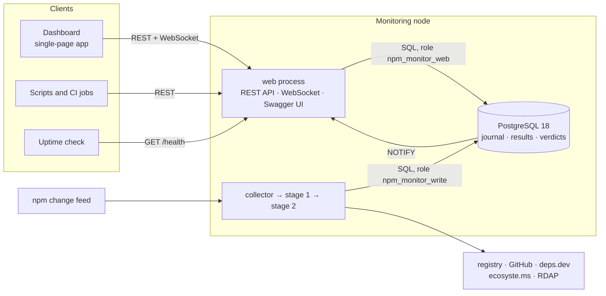
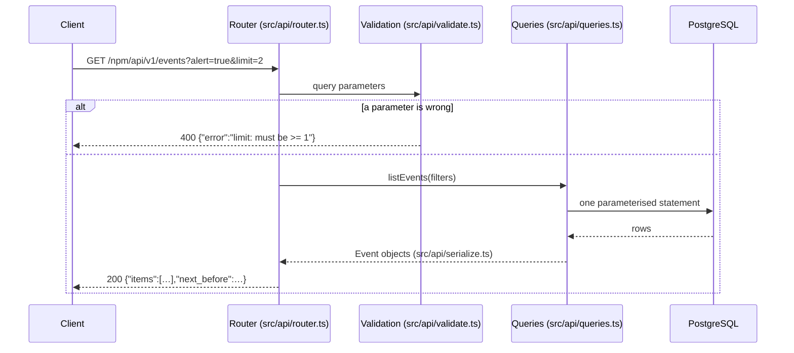
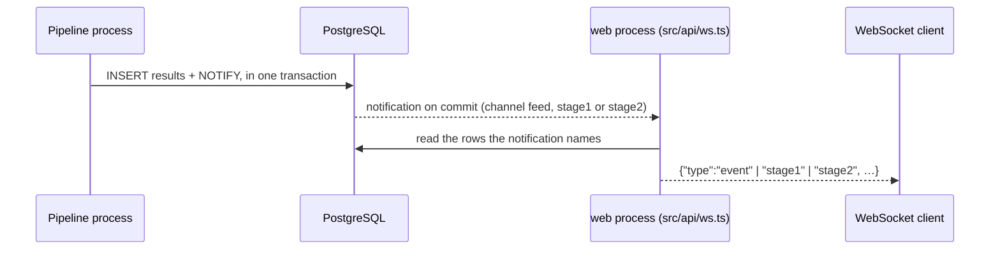

# Architecture overview

Where the API sits in the system, what happens to a request, and which resources it exposes.

## System context

The API is the only way into the data for a client, and it is a thin layer: the web process
holds no state of its own. The pipeline writes to the database; the web process reads from it,
relays the database's notifications to WebSocket clients, and writes one table, the verdicts.
A slow or crashed web process therefore cannot stop the collection, and a restart of the web
process loses nothing.

## Life of a request

A write adds one step before validation: the bearer token is compared with `ANALYST_TOKEN`
(401 when it does not match), then the body is read with a size limit (413) and validated (400).

| Step | Where | What can go wrong |
|---|---|---|
| Routing | `router.ts` | 404 unknown path, 405 wrong method |
| Token (writes only) | `checkBearer` | 401 |
| Validation | `validate.ts` | 400, 413 |
| Query | `queries.ts`, one to three statements per request, parameters always bound | 404 when nothing matches a single-resource request; 500 when the database fails |
| Serialisation | `serialize.ts` | — |

## Life of a pushed message

The notification is sent by the same transaction that stores the data, so a client never hears
about a row that was rolled back. The web process handles notifications one at a time, in
order.

## Resources

| Resource | Identified by | Read | Write | Comes from |
|---|---|---|---|---|
| Event | `seq` | list, card, per package | — | collector (journal), stage 1, stage 2 |
| Stage result | the event's `seq` | inside the event | — | stage 1, stage 2 |
| Finding (verdict) | the event's `seq` | list, inside the event | put, delete (token) | analyst |
| Maintainer history | package name | list | — | stage 2 |
| Statistics | time window | totals, hourly, pulse, features, sources | — | counters of both stages |
| Feature catalogue | feature id | list | — | the code (`src/api/catalogue.ts`) |
| Status, health | — | status, health | — | cursors of the pipeline |

Relations: one event has at most one stage-1 result, one stage-2 result and one verdict. A
package has many events. Stage results exist only for events where something fired (stage 1)
or that were candidates (stage 2), so most events have `stage1: null`.

## Modules

| File | Role |
|---|---|
| `src/api/openapi.ts` | the contract: paths, schemas, security; examples are attached from `examples.ts` |
| `src/api/examples.ts` | captured answers of a running instance (generated) |
| `src/api/router.ts` | maps a request to a query; the only place that knows HTTP |
| `src/api/validate.ts` | parameters and bodies; every rejection is an `ApiError` with a status |
| `src/api/queries.ts` | SQL of the API |
| `src/api/serialize.ts` | database rows → the objects of the contract |
| `src/api/ws.ts` | the WebSocket stream |
| `src/api/swagger.ts`, `static.ts` | Swagger UI and static files, served from the same process |
