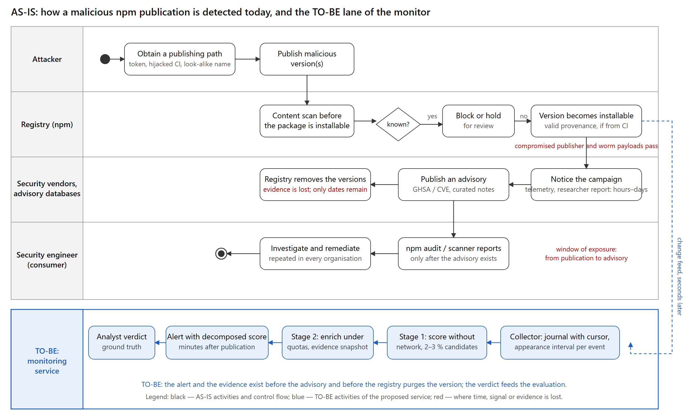
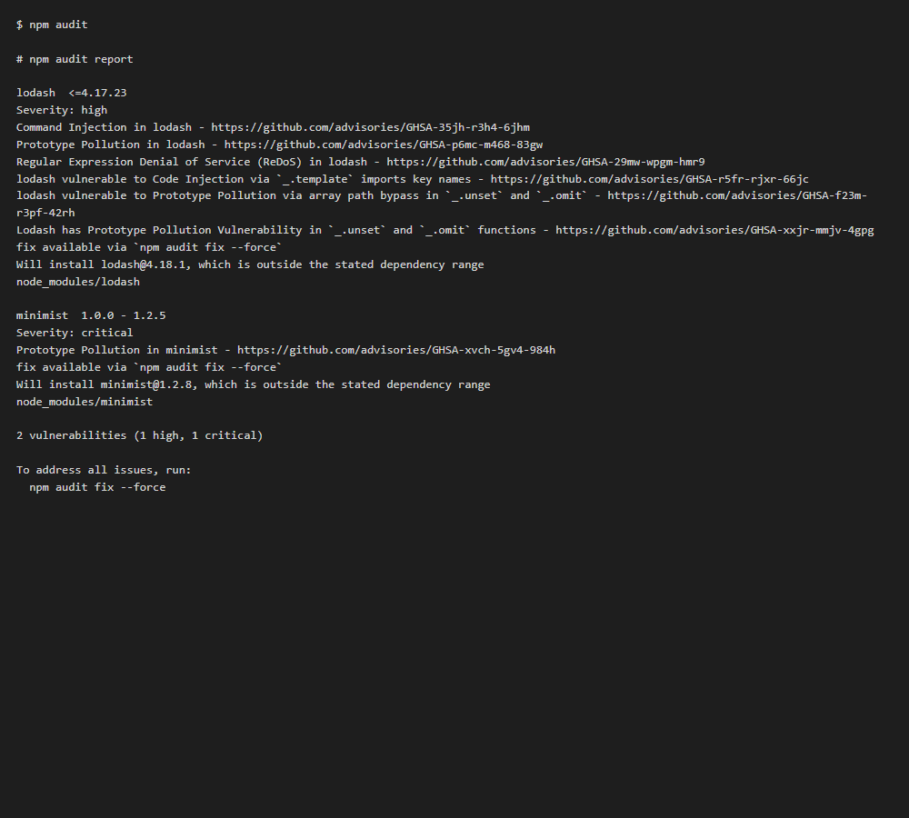
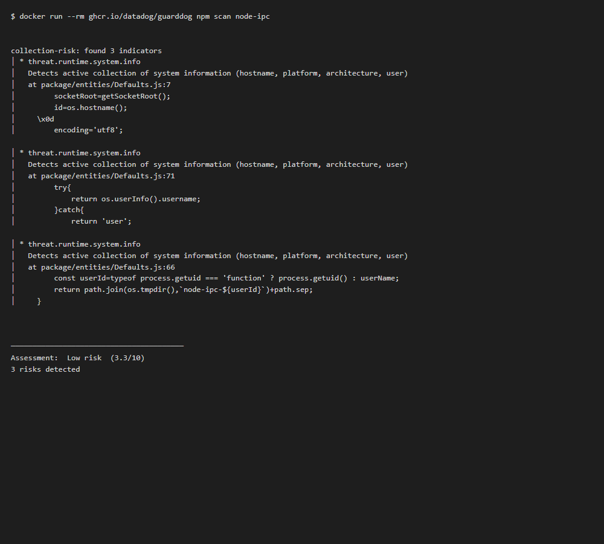
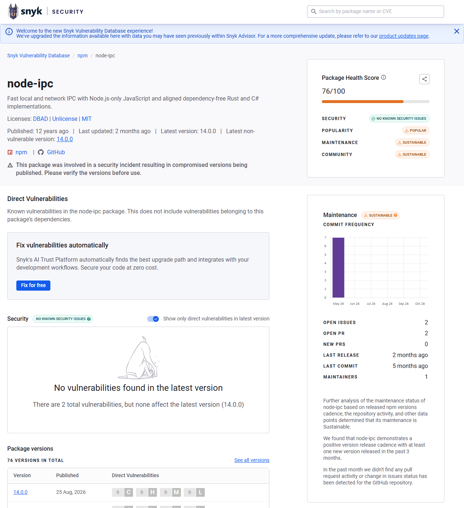
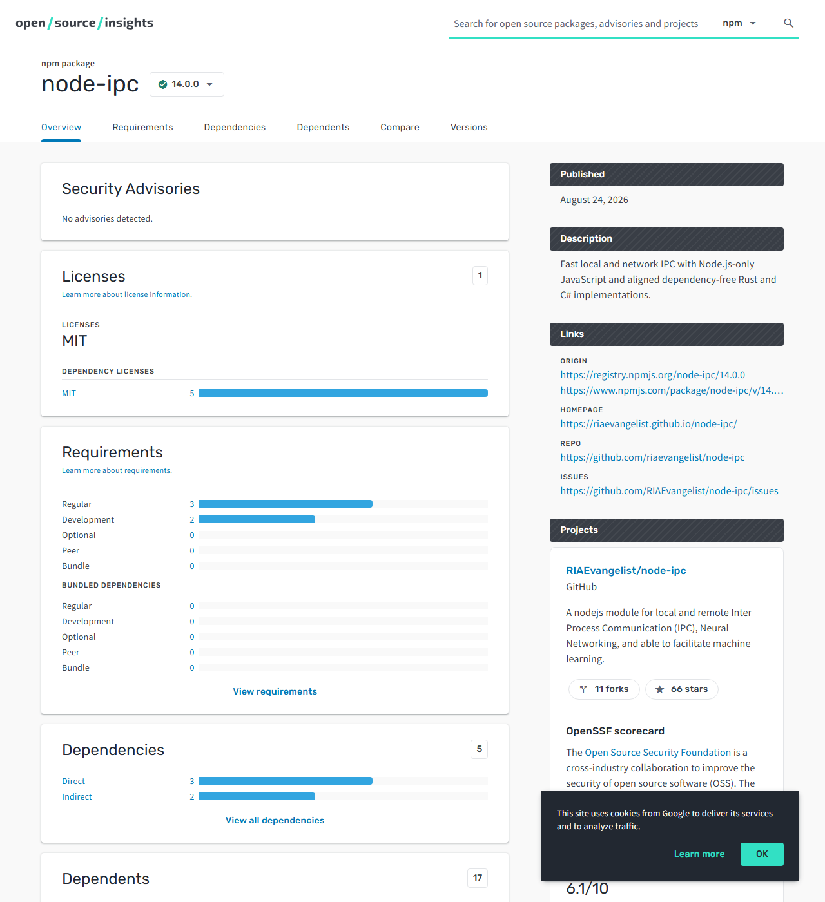
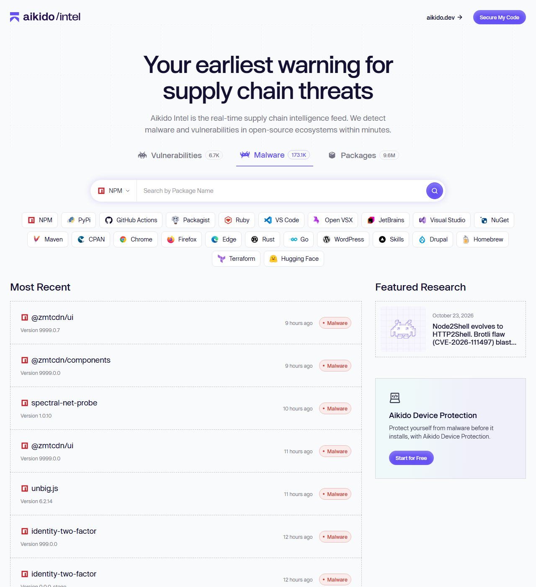
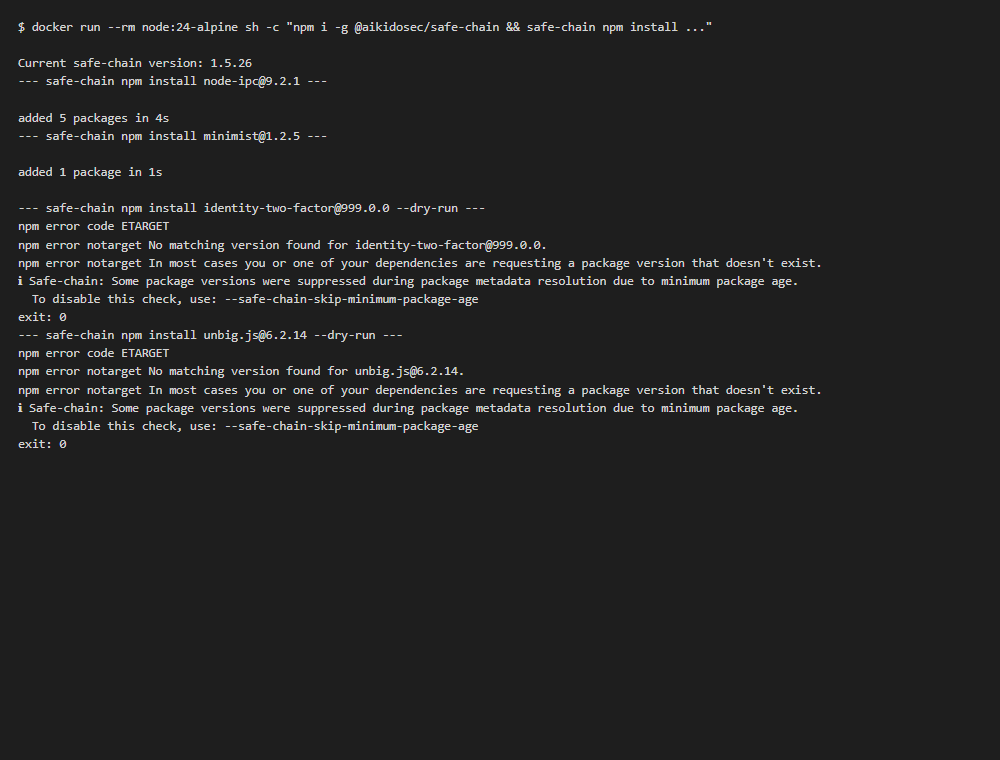
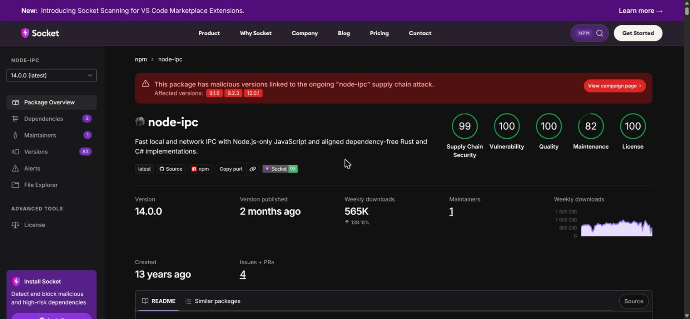
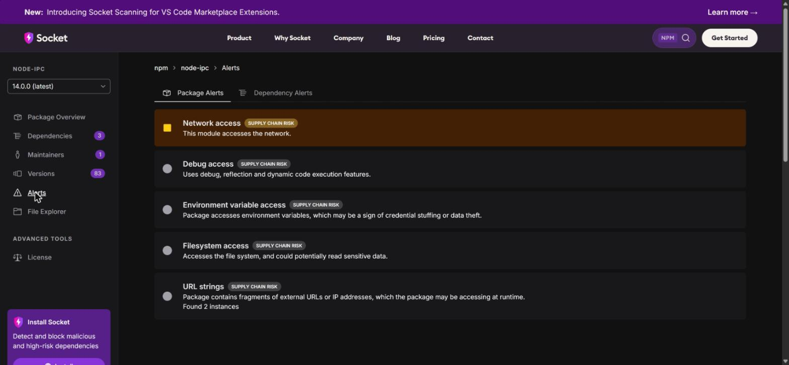

# Chapter 1. Analytical part

## 1.1 Current state of the problem

**Who is involved.** Three groups meet at the moment a package is published to the public npm registry. The *registry* (npm, Inc.) accepts the publication and, since 28 July 2026, scans the content of every new package before it becomes installable [2]. *Consumers* — application security engineers and developers — learn about dangerous packages from vulnerability databases, dependency scanners and the news. *Maintainers* own the packages and the accounts that publish them; when an account or a release pipeline is compromised, the maintainer is usually the last to know.

**How the task is solved today (AS-IS).** Figure 1.1 shows the process as it runs now, with four lanes: attacker, registry, security vendors and the security engineer of a consuming organisation. The attacker obtains a publishing path — a stolen token, a hijacked CI pipeline or a look-alike name — and publishes. The registry's content scan either blocks a package it can recognise, holds it for manual review, or lets it through. For the two attack classes studied in this project the scan lets the package through by construction: in a compromised-publisher attack the content is signed by the legitimate pipeline and carries a valid provenance attestation [7], [8]; in a worm the payload is delivered through a dependency chain the scanner judges file by file. Security vendors notice the campaign from telemetry or from a researcher's report, publish an advisory, and the registry removes the malicious versions. Only then does the consumer's tooling react: `npm audit` and similar scanners compare the lock file with the advisory database [10].

**Where time and data are lost.**

- *Time.* Between the first malicious publication and the advisory lie hours; in the ChainDrop campaign of 4 August 2026 the first malicious version was published at 09:35 UTC and by 13:20 the worm had published malicious versions of 433 further packages [4]. During that window every `npm install` of an affected version succeeds and no consumer tool complains.
- *Signal.* The metadata of a malicious publication is anomalous from the first second — a publisher with no history, three versions in non-adjacent release lines within a minute, a release after years of silence, a lifecycle script that appears out of nowhere [11], [12] — but no service watches this layer continuously for the whole registry. The registry's own change feed exposes it to anyone [5].
- *Evidence.* The registry purges malicious versions. Their publication times survive only in the `time` field of the package document, while the manifests and the publisher of each version are gone. A later investigation cannot reconstruct what happened, and a researcher cannot build a dataset from the registry alone: the purged versions of `node-ipc` keep only their dates (Section 1.3).
- *Effort.* Every consuming organisation repeats the same investigation of the same package after the same advisory, because the evidence was never captured once.

**TO-BE in short.** A monitoring service reads the registry change feed continuously. A first stage scores every event without network requests from its own journal: rhythm of publications, similarity of the name to popular packages, revision jumps, watchlist membership. Only the few percent of events that score as candidates are enriched from external sources under per-source quotas: publisher history, maintainers, manifest changes, release lines, repository state. An alert with a decomposed score and an evidence snapshot reaches the analyst minutes after the publication, before the advisory exists and before the registry purges the version. The analyst's verdict is recorded and becomes the ground truth for measuring the service. Figure 1.1 shows this TO-BE lane at the bottom of the same diagram.

## 1.2 Review of sources

The sources fall into five groups. For each group the review states what it contributes and where it stops; the requirements of Chapter 2 refer back to these conclusions.

**Taxonomies and empirical studies.** Ohm et al. reviewed 174 malicious packages from npm, PyPI and RubyGems and built the first attack tree of open-source supply-chain attacks; most packages trigger on installation, and typosquatting and account compromise are the dominant vectors [11]. Zimmermann et al. measured the npm dependency graph and showed that compromising one of a few hundred maintainer accounts reaches thousands of packages [13]. Duan et al. reported that metadata and install-time behaviour already separate a large share of malicious packages [14]. Ladisa et al. systematised 107 attack vectors and named publishing from a compromised account and manipulation of release lines among the vectors that content signing does not close [12]. Zahan et al. identified "weak links" in npm — inactive maintainers, expired domains, install scripts — as signals measurable from metadata [15]. *Conclusion:* the attack classes of this project are known, and the metadata signals that expose them are listed, but as static package properties, not as events in a continuous stream.

**Detection approaches.** Sejfia and Schäfer trained a classifier on package contents with practical precision on npm, at the price of a tarball and a labelled corpus [16]. Vu et al. (LastPyMile) detect the discrepancy between the source repository and the published artefact, a strong signal for a hijacked pipeline, at the price of cloning the repository for every release [17]. Taylor et al. (TypoGard) detect typosquatting from name distance and popularity at install time [18]. *Conclusion:* each approach covers one attack class, most need the content or the repository, none runs over the whole registry in real time, and none keeps evidence after the registry removes the version. Chapter 2 therefore requires a two-stage design, explainable features instead of a trained model, and evidence snapshots at observation time.

**Industry reports and incident write-ups.** Sonatype attributes 96.6 % of malicious open-source packages in Q2 2026 to npm [1]. The write-ups of ChainDrop [4], [19] (Aikido reported it as a new wave of the Shai-Hulud worm [3]) and node-ipc [6], [20] give the timings used for the replay scenarios of the evaluation. ChainDrop: 11 packages in the first wave, 433 more by 13:20, 444 packages and 2 212 versions in under four hours [4]; Aikido counted 1 381 versions in its first update [3]. node-ipc: three versions into non-adjacent lines on one day, from a maintainer account that had published none of the recent releases [20]. Three incidents of 2025 are kept apart as held-out scenarios, not used to design or calibrate the features: the chalk/debug maintainer compromise [21], the first Shai-Hulud worm [22] and the nx release-pipeline compromise [23]. The registry's announcement of pre-publication scanning [2] states its own limit: it blocks the malware it can recognise. *Conclusion:* the incidents of 2026 passed a content gate already in place; the residual risk after that gate is what the project measures.

**Standards and provenance.** SLSA provenance [8] and npm provenance statements [7] prove that an artefact was built by a given pipeline from a given commit — authenticity, not intent: ChainDrop's poisoned versions carried valid attestations because the pipeline itself was compromised. NIST SP 800-218 [9] frames the consumer's duty to verify third-party components but prescribes no mechanism for the hours before an advisory. *Conclusion:* provenance is recorded as evidence but has no weight in the risk score.

**Data sources and their limits.** The registry API documents the `_changes` feed and the package document [5]; deps.dev [24], ecosyste.ms [25], RDAP [26] and the GitHub REST API [27] expose dependency, repository, domain-registration and commit data under rate limits. Measurements made for this project in October 2026 set the design's numbers: the feed carries 1.0–1.4 events per second (90 000–120 000 events a day) with no payload beyond the package name and a revision number; a package document is 71 KB at the median and 8 MB at the 99th percentile, so one per event would cost 18–27 GB a day; GitHub allows 5 000 requests an hour with a token and 60 without. *Conclusion:* enriching every event is impossible within quotas, which determines the two-stage architecture and the budget layer of Chapter 2. Legal and ethical sources — the GDPR [28] and WCAG 2.1 [29] — are applied in Section 2.8.

## 1.3 Analysis of analogs

Six solutions were examined and all six were tried out, five of them on the same reference package, `node-ipc`, which had three malicious versions published and purged on 14 May 2026 [6]; the figures show what each tool reports five months later.

**npm audit** (open source, part of the npm client) compares the dependency tree of a project with the GitHub Advisory Database. In the trial project with `lodash@4.17.15`, `minimist@1.2.5` and `node-ipc@9.2.1` it reported two vulnerabilities, both known for years, and nothing about the node-ipc incident (Figure 1.2): no advisory covers the purged versions, so the tool has nothing to compare with. It works only after disclosure and only for packages already in a project.

<table class="figs"><tr><td> Figure 1.2 — npm audit on the trial project: two known vulnerabilities, nothing about node-ipc</td><td> Figure 1.3 — GuardDog scan of node-ipc from the Docker image: content indicators only</td></tr></table>

**GuardDog** (Datadog, open source) [30] scans the content of a package tarball with semantic rules for malicious patterns. Run from its Docker image against `node-ipc`, it reported three low-risk indicators of "system information collection" in the legitimate code (hostname and user name used to build the socket path) and an overall assessment of 3.3/10 (Figure 1.3). The tool sees content, not history; it cannot know that the publishing account differed from the previous releases, and it cannot scan a version the registry has already removed.

**Snyk Advisor / Snyk Vulnerability Database** (commercial, free tier) [31] shows a package health score from security, popularity, maintenance and community signals. For `node-ipc` it shows 76/100, "no known security issues" in the latest version, and a banner that "this package was involved in a security incident resulting in compromised versions being published" (Figure 1.4). The banner is a manually curated note added after the incident; the compromised versions themselves are absent from the version list because the registry purged them.

<table class="figs"><tr><td> Figure 1.4 — Snyk Advisor page of node-ipc: a curated incident note, no trace of the purged versions</td><td> Figure 1.5 — deps.dev page of node-ipc: no advisories, a repository scorecard</td></tr></table>

**deps.dev / OpenSSF Scorecard** (Google and the Open Source Security Foundation, open data) shows advisories, licences, dependencies and a Scorecard of repository practices. For `node-ipc` it reports "no advisories detected" and a Scorecard of 6.1/10 (Figure 1.5). The data describes the repository and the dependency graph, not individual publications.

**Aikido Intel and Aikido Safe Chain** (Aikido Security; the feed is public, Safe Chain is open source). Aikido Intel is a feed of malware and vulnerabilities that the vendor detects by scanning new packages, published within hours of the publication; its npm malware tab on 28 October 2026 listed packages such as `identity-two-factor@999.0.0` and `@zmtcdn/ui@9999.0.7` flagged 9–12 hours earlier (Figure 1.6) [32]. Safe Chain wraps the package manager and refuses to install versions that the feed lists; it also hides versions younger than a minimum age during resolution [33]. In the trial (Figure 1.7) Safe Chain installed `node-ipc@9.2.1` and `minimist@1.2.5` without a remark. For two versions listed as malware that morning, npm reported "no matching version" and Safe Chain noted that "some package versions were suppressed due to minimum package age". The registry had already removed them, and the age rule had hidden any remaining fresh version. Safe Chain is the only analog with a temporal metadata rule, applied at install time on the consumer's machine; it does not look at the publisher or the history of the package, and the feed behind it is still a list of recognised malware.

<table class="figs"><tr><td> Figure 1.6 — Aikido Intel, npm malware tab: detections published hours after the malicious versions</td><td> Figure 1.7 — Aikido Safe Chain in a container: benign versions pass; listed versions are already gone and suppressed by the minimum-age rule</td></tr></table>

**Socket.dev** (commercial, free tier for open source) analyses package contents at install and pull-request time and flags behaviours such as install scripts, network access, obfuscation and, in its newer releases, publisher-related signals such as a new maintainer [34]. Its page for `node-ipc` (Figure 1.8, left) shows a Supply Chain Security score of 99 for the latest version and a banner "this package has malicious versions linked to the ongoing node-ipc supply chain attack" naming 9.1.6, 9.2.3 and 12.0.1 with a link to a campaign page. The Alerts tab (Figure 1.8, right) lists the behaviours its content analysis found in the latest, benign version: network access, debug access, environment-variable access, file-system access and URL strings, all marked "supply chain risk". Socket is the closest analog in intent: by its own account it reacted to the incident within minutes [20]. It did so as a content scanner on the consumer's side, and the attribution to a campaign was curated afterwards. The purged versions themselves are no longer analysable.

<table class="figs"><tr><td> Figure 1.8 (left) — Socket.dev page of node-ipc: campaign banner with the three malicious versions, score 99 for the latest version</td><td> Figure 1.8 (right) — Socket.dev alerts for the latest benign version: behaviour findings from content analysis</td></tr></table>

Table 1.1 compares the six solutions with the proposed system on eight criteria.

Table 1.1 — Comparison of analogs

| Criterion | npm audit | GuardDog | Snyk Advisor | deps.dev / Scorecard | Aikido Intel + Safe Chain | Socket.dev | Proposed system |
|---|---|---|---|---|---|---|---|
| Layer analysed | advisory database | package content | advisories + curated metadata | repository practices, dependency graph | vendor's content scan; version age at install | package content + some publisher signals | publication metadata and history |
| Moment of detection | after an advisory exists | on scan of a tarball | after an advisory or curation | periodic | hours after publication; at install | at install / pull request | minutes after publication |
| Covers a compromised publisher | no | no | after curation | no | no (content and age only) | partly (new-maintainer signal; campaign banner curated afterwards) | yes (publisher vs. release history) |
| Watches the whole registry continuously | no | no | no | no (periodic) | vendor-side yes; consumer sees a list | no (per consumer) | yes (change feed) |
| Explainable per-finding evidence | advisory link | rule and code line | score components | scorecard checks | verdict label only | alert reasons | feature, value, threshold, weight |
| Evidence kept after the registry purges a version | no | no | note only | no | listing only | banner only; versions not analysable | yes (snapshot at observation) |
| Licence and cost | open source, free | open source, free | commercial, free tier | open data, free | feed free to read; Safe Chain open source | commercial, free tier | open source |
| API and automation | CLI, JSON | CLI, JSON | web, API on paid tiers | REST API | CLI wrapper; feed on the web | CLI, GitHub app, API | REST, WebSocket, OpenAPI |

**What is missing.** All six analogs are either *reactive* (they need an advisory, a curated note or the vendor's own detection list) or *content-based* (they need the tarball, which the attacker controls and the registry later removes). The fastest of them, Aikido Intel, reports hours after the publication and gives the consumer a label, not the evidence. None of them watches the registry's publication stream for the consumer continuously, none reasons about the *history* of a package — who published the previous versions, how often, into which lines — and none keeps evidence of a publication once the registry purges it. The compromised-publisher class [12], the dominant class of 2026 [1], [4], falls between them. These three gaps define the proposed system.

## 1.4 Chapter conclusions

The analysis identified six problems. Each is linked to an epic of the backlog (Appendix A) or to a KPI of Section 2.1.

Table 1.2 — Problems identified and what the solution must do

| ID | Problem | What the new solution must be able to do | Linked epic / KPI |
|---|---|---|---|
| P1 | Nobody watches the registry's publication stream continuously; consumers react only after an advisory | read the change feed without loss across restarts and outages | E1 Durable collection; KPI-1 continuous operation |
| P2 | Enriching every event from external sources is impossible: 90 000–120 000 events a day against quotas of thousands of requests an hour | score every event without network requests and pass only candidates to enrichment | E2 Cheap filtering; KPI-2 pass-through, KPI-3 cost reduction |
| P3 | The attack classes of 2026 are visible in publication metadata and package history, which no tool reasons about | compare the publisher, the manifest, the release lines and the repository with the package's own history | E3 Enrichment; KPI-4 recall on replayed incidents |
| P4 | Verdicts of existing tools are opaque scores or binary advisories | decompose every alert into named features with value, threshold and weight; let the analyst record a verdict | E4 Explainable alerts; KPI-5 precision |
| P5 | The registry purges malicious versions; evidence and datasets vanish | store a snapshot of the package document at the moment of observation | E3 Enrichment (evidence); E8 Evaluation |
| P6 | No one measures the residual risk after the registry's content gate | replay documented incidents on the recorded background and report recall, precision, delay and request reduction | E8 Evaluation; KPI-4, KPI-5, KPI-6 |

In short, the new solution must be a continuous, metadata-first monitor of the npm registry with a cheap first stage, a budgeted second stage, explainable alerts, durable evidence and a reproducible evaluation. Chapter 2 turns these statements into requirements.
