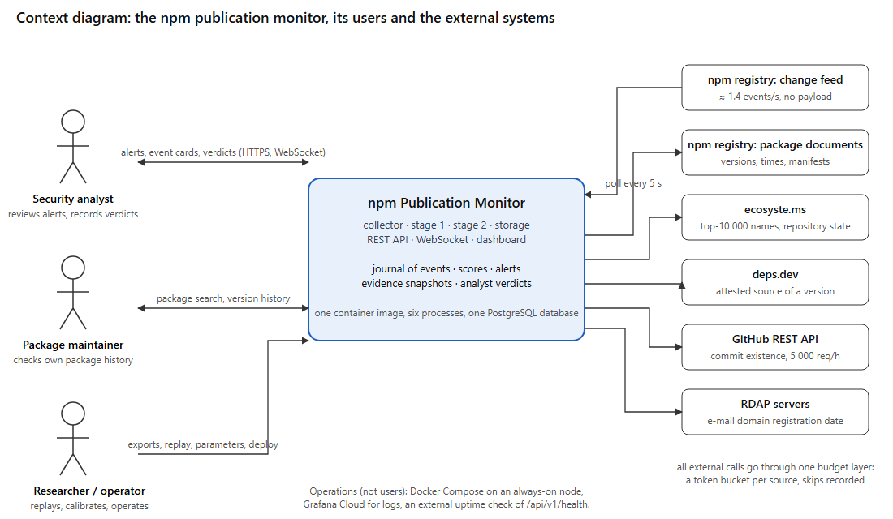
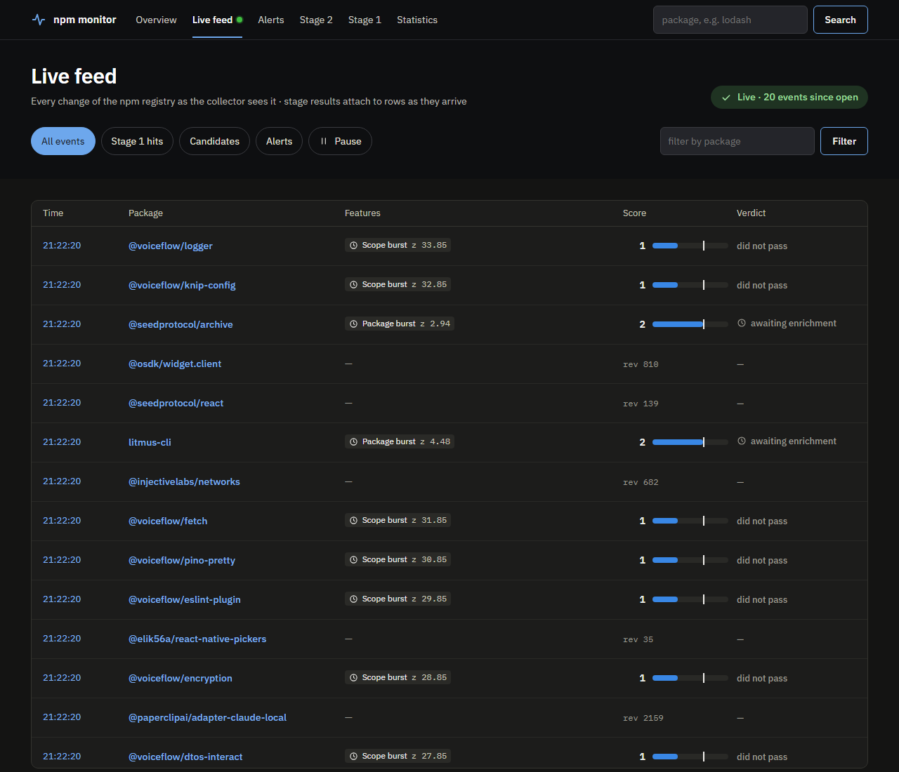
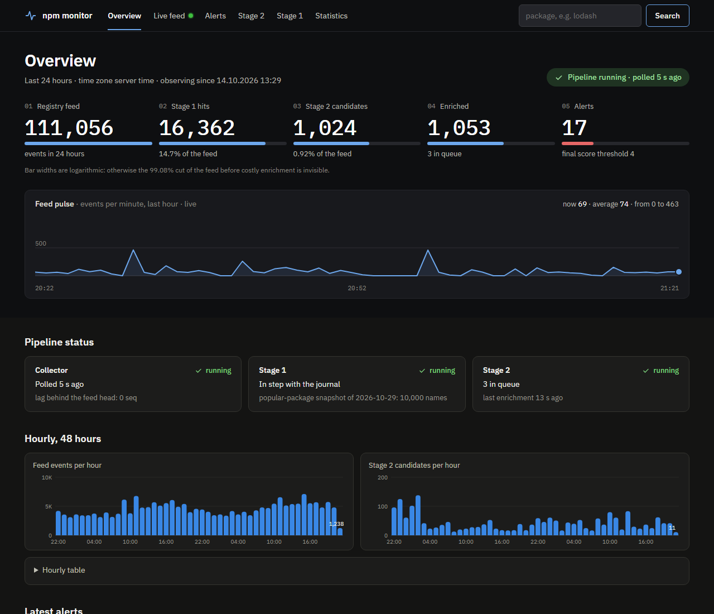
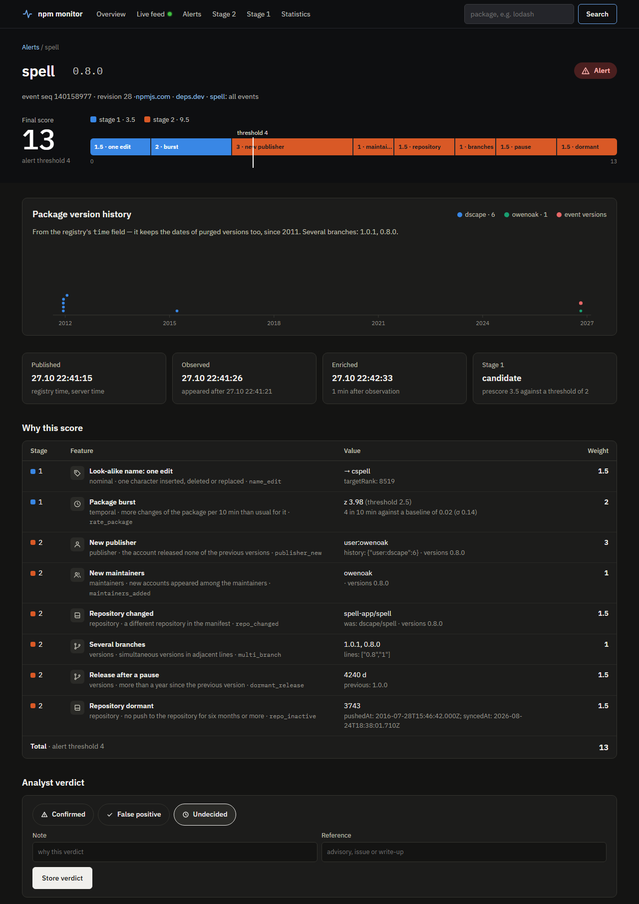

# Chapter 2. System requirements

## 2.1 Vision and goals

**Vision statement.** For security engineers and maintainers who depend on the npm registry, the npm Publication Monitor is a continuous early-warning service that flags suspicious package publications minutes after they happen, before the code is analysed and before the registry removes the evidence. Unlike content scanners and vulnerability databases, which see malware only once it is recognised, the monitor works on publication metadata and package history, where a compromised publisher is visible and a valid attestation proves nothing.

**Business goals.** (G1) Reduce the window between a malicious publication and the first actionable signal from hours to minutes. (G2) Make the signal cheap enough to run over the whole registry on one node within the quotas of public APIs. (G3) Make every alert explainable and verifiable by an analyst. (G4) Keep evidence of every flagged publication after the registry purges it. (G5) Measure the residual risk after the registry's content gate with a reproducible method.

Table 2.1 — Key performance indicators

| KPI | Goal | Baseline (measured before design, Section 1.2) | Target |
|---|---|---|---|
| KPI-1 Continuous operation | G1, G2 | no continuous observer of the feed exists | feed coverage ≥ 99 % of the observation period (sum of gaps longer than 5 minutes ≤ 1 %; every gap documented) |
| KPI-2 Stage-1 pass-through | G2 | 100 % of events would need enrichment without a pre-filter | ≤ 3 % of events reach stage 2 |
| KPI-3 External requests per day | G2 | ≈ 380 000 requests a day to enrich every event (measured mean of 89 000 events a day × 4.2 requests per enriched event) | ≤ 15 000 requests a day; no source quota exhausted |
| KPI-4 Recall on replayed incidents | G1, G5 | no analog gives the consumer a signal with evidence before the vendor's advisory; both reference incidents were reported hours after the first publication [3], [20] | an alert in every insertion of the two reference incidents (node-ipc, ChainDrop) and in at least two of the three held-out incidents (chalk/debug, Shai-Hulud, nx), replayed with parameters frozen beforehand |
| KPI-5 Alerts per day | G3 | ≈ 250 alerts a day over the registry with the initial expert weights (first 64 h of background, before calibration) | (a) over the registry, for the operator: ≤ 30, ≤ 10 after calibration; (b) for one consumer's dependency list of about 2 000 packages: ≤ 3, so that a 15-minute review fits (measured: 1.6 a day on the top-10 000 packages, 28 Oct–10 Nov) |
| KPI-6 Detection delay | G1 | hours (vendor advisory) to days (`npm audit` after the advisory database update) | ≤ 10 minutes from the first publication of a wave to the alert, on the reference and the held-out incidents |

## 2.2 Stakeholders and users

Table 2.2 lists the stakeholders with their interest, influence and involvement.

Table 2.2 — Stakeholders, interest and influence

| Role | Interest | Influence | Involvement |
|---|---|---|---|
| Supervisor | scope and method fit a bachelor project; honest evaluation | H | approves deviations from the description; reviews chapters |
| Reviewing expert and committee | a working system, requirements that can be verified, a clear defence | H | reads this document; attends the defence |
| Security analyst (primary user) | early warning with enough evidence to decide in minutes | M | reviews alerts, records verdicts |
| Package maintainer (secondary user) | a signal that their package was published unexpectedly | L | searches a package, reads its version history |
| Researcher / operator (the author) | a recorded background, deterministic engines, reproducible replays | H | builds, calibrates, operates, evaluates |
| External data providers (npm, ecosyste.ms, deps.dev, GitHub, RDAP) | fair use within rate limits and terms | M | passive; protected by the quota layer |

**System users (actors of the use cases).** *Security analyst*, *Package maintainer*, *Researcher/operator* (drawn as two actors, researcher and operator, in the use case diagram, Figure B.3); and three system actors: the *npm registry* (change feed and package documents), the *external sources* (ecosyste.ms, deps.dev, GitHub, RDAP) and the *uptime check* that polls the health endpoint.

**Personas.** Composite personas from the document analysis and the supervisor sessions (no interviews, Section 2.8).

*Marta, application security engineer* at a 40-person company with 1 900 packages in the lock file. She has 15 minutes a day for supply-chain news and no budget for a commercial scanner. She wants only the alerts on the packages she depends on, enough evidence to decide in five minutes, and a way to mark what she has already checked: at most three decisions a day (KPI-5 b).

*Ilya, maintainer* of a library with 300 000 weekly downloads published only through GitHub Actions. He wants to be told that a human account published his package after months of CI-only releases, and to see the whole version history on one page when a user asks "was this release yours?".

## 2.3 Project scope

**In scope.** Continuous collection of the registry change feed with a persisted cursor; stage 1 — temporal, nominal and version lanes and a watchlist — without network requests; stage 2 — enrichment from five sources under quotas; weighted-sum scoring, evidence snapshots, maintainer-set history, analyst verdicts and a filter by a consumer's dependency list; a REST API with an OpenAPI 3.1 contract [35] and a WebSocket stream; a single-page dashboard usable on a phone; containerised deployment with health checks, central logs and an external uptime check; a privacy notice, retention periods and an exclusion list (Section 2.8); replay-based evaluation on the recorded background.

**Out of scope.** Analysis of package content (the layer the registry's gate already covers); machine learning (no labelled corpus, explainability is a requirement); comparison of the tarball with the source repository (high traffic cost for a signal that cheaper features approximate); dependency confusion (needs a second data source — corporate namespaces); blocking or quarantining packages (the system informs, it does not act on the registry).

Table 2.3 lists the assumptions and constraints with their consequences for the design.

Table 2.3 — Assumptions and constraints

| Kind | Statement | Consequence |
|---|---|---|
| Deadline | the BA block by 30 October 2026, the full thesis by the programme's deadline; an observation period of weeks, not months | evaluation uses replayed incidents on the recorded background, not a long-term incident count |
| Resources | one developer; one always-on home node; no hosting budget | one container image, one database; hybrid cloud (ingress, logs, uptime check in managed services) |
| Access to data | the change feed and package documents are public; the feed event carries only the package name and a document revision | version rules run on stage 2, where the package document is fetched |
| External APIs | GitHub 5 000 requests/h with a token, ecosyste.ms and deps.dev unmetered but rate-limited, RDAP per registry | a token bucket per source; a skipped request is recorded on the event |
| Assumption | every publication produces at least one feed event; the `time` field keeps the dates of purged versions (verified on node-ipc and on the 2025 versions of nx, debug, chalk and @ctrl/tinycolor); incident write-ups give timings to the minute | replay scenarios can be built from public write-ups and the registry's own dates |

## 2.4 Solution concept

The system is a pipeline of six processes around one PostgreSQL database (Figure 2.1; component view in Figure B.5). The *collector* polls the registry change feed every five seconds and writes each page of events together with the new cursor in one transaction; every event records the interval in which it can have appeared, so catch-up after downtime does not look like a burst. *Stage 1* scores every event from the journal alone: bursts per package, scope and name cluster against a 24-hour baseline, breadth of "wake-ups" of mature packages across unrelated namespaces, similarity of the name to the top-10 000 names, revision jumps and regressions, membership of the top-1 000 watchlist. An event becomes a candidate at a preliminary score of 2. *Stage 2* enriches candidates under per-source quotas and compares the publication with the package's own history: publisher against previous releases, maintainers and the age of the e-mail domain, lifecycle scripts, size and file count, dependencies, release lines, repository state. An alert needs a final score of 4 with at least 2 points of stage-2 evidence; a version or package the registry has already removed is a confirmation, not evidence, because nothing is left to show. The *web* process serves the REST API, a WebSocket stream of events and results, Swagger UI and the dashboard. The *popular* process refreshes the top-10 000 names daily; *migrate* applies schema migrations.

Figure 2.1 — Context diagram: users, the system and external systems (full size in Appendix B)

Table 2.4 — Alternatives considered and the rationale for the choice

| Alternative | How it would work | Why it was not chosen |
|---|---|---|
| A. Content scanning of every new tarball | download every published version, run GuardDog-style rules, alert on patterns | duplicates the registry's gate, which the 2026 incidents passed; blind to a compromised publisher; 18–27 GB of traffic a day (Section 1.2) |
| B. Polling a fixed list of important packages | poll the package documents of the top-N packages and compare versions | misses new packages, typosquats and worm propagation across namespaces; N = 10 000 at a 5-minute period costs ≈ 3 million requests a day |
| **Chosen: metadata stream with two-stage filtering** | read the change feed once, score every event from the journal, enrich 2–3 % of events under quotas, keep evidence | covers the whole registry for one feed connection; metadata exposes the attack classes the gate misses; enrichment cost bounded by the pre-filter; every verdict explainable |

## 2.5 Functional requirements

**Epics.** E1 Durable collection; E2 Cheap filtering (stage 1); E3 Enrichment and evidence (stage 2); E4 Explainable alerts and verdicts; E5 Dashboard and API; E6 Adaptive user interface; E7 Operations; E8 Evaluation by replay; E9 Calibration. Table 2.5 decomposes the epics into user stories with their MoSCoW priority; Appendix A gives every story in full with its acceptance criteria.

Table 2.5 — Epics and user stories (MoSCoW)

| Epic | Priority | User stories |
|---|---|---|
| E1 Durable collection | Must | US1.1 resume from the saved cursor (M); US1.2 appearance interval per event (M); US1.3 monthly partitions (S) |
| E2 Cheap filtering | Must | US2.1 burst of a quiet package (M); US2.2 look-alike names (M); US2.3 top-1 000 always checked (M); US2.4 deterministic stage 1 without I/O (M); US2.5 wave across unrelated namespaces (S) |
| E3 Enrichment and evidence | Must | US3.1 publisher vs release history (M); US3.2 manifest vs version before the burst (M); US3.3 hourly budget per source (M); US3.4 evidence snapshot (M); US3.5 e-mail domain age via RDAP (S) |
| E4 Explainable alerts and verdicts | Must | US4.1 decomposed alert (M); US4.2 threshold with stage-2 evidence (M); US4.3 analyst verdict with a note (M); US4.4 repeats within six hours marked (S) |
| E5 Dashboard and API | Must | US5.1 health and lag on one page (M); US5.2 smooth live feed (M); US5.3 filters (M); US5.4 hourly statistics (S); US5.5 OpenAPI and Swagger UI (M); US5.6 package page (S); US5.7 alerts for my dependency list (S) |
| E6 Adaptive user interface | Should | US6.1 feed and card at phone width (S) |
| E7 Operations | Should | US7.1 alert when the collector stops (S); US7.2 central logs (C); US7.3 retention and exclusion of personal data (S) |
| E8 Evaluation by replay | Must | US8.1 scenarios inserted into the recorded background (M); US8.2 recall, precision, delay and request reduction per scenario (M) |
| E9 Calibration | Could | US9.1 thresholds from background distributions (C) |

**Acceptance criteria.** Every Must story has acceptance criteria in Given/When/Then form in Appendix A; for example, US2.1: given a package with no publication in the last 24 hours, when three or more changes of it (by revision increment) arrive within 10 minutes with reliable timestamps, then the third event is a candidate with the feature `rate_package` and its value, within 60 seconds.

**Mockups.** Figures 2.2–2.4 show the layouts of the three key stories implemented in the prototype dashboard: the live feed (US5.2, US5.3), the overview with the funnel and the pipeline status (US5.1), and the event card with the decomposed score (US4.1, US4.3).

<table class="figs"><tr><td> Figure 2.2 — Live feed with filters, chips of fired features and in-place stage results (US5.2, US5.3)</td><td> Figure 2.3 — Overview: funnel of the last 24 hours, feed pulse and pipeline status (US5.1)</td></tr></table>

Figure 2.4 — Event card: score composition, version timeline, feature table and analyst verdict (US4.1, US4.3)

Table 2.6 traces every goal to its KPIs, epics and stories.

Table 2.6 — Traceability from goals to epics and stories

| Goal | KPI | Epic | Stories |
|---|---|---|---|
| G1 window from publication to signal | KPI-1, KPI-4, KPI-6 | E1, E2, E4 | US1.1, US1.2, US2.1, US2.2, US2.3, US2.5, US4.2 |
| G2 whole registry within quotas | KPI-2, KPI-3 | E2, E3, E5, E7 | US2.4, US3.3, US5.1, US7.1 |
| G3 explainable, verifiable alerts | KPI-5 | E4, E5, E6 | US4.1, US4.3, US4.4, US5.2, US5.3, US5.5, US5.7, US6.1 |
| G4 durable evidence | KPI-4 | E3, E5 | US3.1, US3.2, US3.4, US3.5, US5.6 |
| G5 measured residual risk | KPI-4, KPI-5, KPI-6 | E5, E8, E9 | US8.1, US8.2, US9.1, US5.4 |
| Legal compliance (Section 2.8) | — | E7 | US7.3 |

## 2.6 Use case scenarios

The use case diagram with all actors is Figure B.3 in Appendix B.

**UC1 — Review an alert.** *Actor:* security analyst. *Precondition:* the pipeline is running; an event has reached the alert threshold; the analyst has the analyst token. *Main flow:* (1) the analyst opens the Alerts list and sees the new alert with its package, versions, score and feature chips; (2) the analyst opens the event card; (3) the card shows the score composition, the version timeline with the publisher of every version, the feature table with values and thresholds, the comparison with the previous version, the answers of each source and the evidence snapshot; (4) the analyst checks the package on the registry and the repository; (5) the analyst records the verdict *confirmed* with a note; (6) the system stores the verdict and shows it on the card and in the lists. *Alternative flow A1 (false positive):* at step 5 the analyst records *false positive*; the verdict is stored; later alerts for the same package remain visible but the analyst sees the earlier verdict on the package page. *Alternative flow A2 (source skipped):* at step 3 one source shows "skipped: quota"; the analyst decides from the remaining evidence or waits for the quota window; the skip is recorded on the event. *Alternative flow A3 (no token):* at step 5 the request is refused; the card asks for the token.

**UC2 — Check an unexpected release of own package.** *Actor:* package maintainer. *Precondition:* the maintainer has the package name. *Main flow:* (1) the maintainer types the name into the search box; (2) the package page lists every journal event of the package with chips, scores and verdicts, and the history of the maintainer set; (3) the maintainer opens the latest event; (4) the timeline shows that the last version was published by an account different from the previous releases, with the feature `publisher_new`; (5) the maintainer revokes the token on the registry and notifies users. *Alternative flow A1 (no events):* at step 2 the page states that the package has no events in the observation period. *Alternative flow A2 (benign release):* at step 4 the publisher matches the history and no stage-2 feature fired; the maintainer closes the page.

The system sequence diagram of UC1 (Figure B.4 in Appendix B) starts when the registry publishes a version: the collector stores the event, stage 1 scores it, stage 2 enriches it and stores the evidence, the web process pushes the result to the open dashboard over the WebSocket, and the analyst records the verdict.

## 2.7 Non-functional requirements

Table 2.7 states the non-functional requirements with measurable indicators.

Table 2.7 — Non-functional requirements with measurable indicators

| ID | Area | Requirement | Indicator and value | Linked KPI / story |
|---|---|---|---|---|
| NFR-1 | Durability | no event lost or duplicated across restarts and outages | cursor and events written in one transaction; idempotent inserts; a restart test shows the same event count as the feed | KPI-1, US1.1 |
| NFR-2 | Performance | stage 1 keeps up with the feed with a margin | stage 1 sustains ≥ 1 000 events/s on the target node (> 700× the measured 1.4 events/s); a batch of 1 000 journal events is scored in ≤ 1 s | KPI-2, US2.4 |
| NFR-3 | Latency | an alert is visible soon after the publication | ≤ 10 minutes from the first event of a wave to the alert on the dashboard (settle time 60 s included) | KPI-6, US4.2 |
| NFR-4 | Availability | unattended operation with automatic recovery | processes restart after a reboot (`restart: unless-stopped`); health endpoint returns 503 when the collector is silent for 5 minutes; an external check polls it every minute | KPI-1, US5.1, US7.1 |
| NFR-5 | Capacity | the journal holds the whole observation period | 90 000–120 000 events a day for 90 days (≈ 11 million rows) in monthly partitions [36]; results stored only for hits | US1.3 |
| NFR-6 | Security | read access for analysts only, one authenticated write | the dashboard and the API are reachable only inside the deployment's private network or after authentication; the only write endpoint requires a bearer token; no secrets in the repository; parameterised SQL; a strict Content-Security-Policy | US4.3, US5.5, US7.3 |
| NFR-7 | Usability | an alert can be assessed without leaving the card | all features, values, thresholds, source answers and evidence on one page; ≤ 3 clicks from the alert list to a recorded verdict | KPI-5, US4.1, US4.3 |
| NFR-8 | Accessibility | the dashboard is usable on a phone and with a keyboard | feed and card functional at 390 px; every control a real button, link or input with a visible focus ring; alert state never by colour alone; contrast ≥ 4.5:1 for text | US6.1 |
| NFR-9 | Fair use | external sources are used within their terms | a token bucket per source with the published limits; an identifying `User-Agent`; skipped requests counted hourly | KPI-3, US3.3 |
| NFR-10 | Reproducibility | the evaluation can be repeated by a third party | deterministic engines; a replay tool with a fixed seed; parameter sets identified by a hash stored with every result | KPI-4, US2.4, US8.2 |

## 2.8 Legal and ethical requirements

**Personal data.** The system processes only data that the registry publishes openly: package names, version numbers, timestamps, publisher user names and the e-mail addresses attached to versions and maintainers. User names and e-mail addresses are personal data under the GDPR [28]. The processing is not neutral: an alert attaches an automatic label to a named account, and before calibration most of about 250 alerts a day were false.

**Legal basis and balancing test.** Legitimate interest, Article 6(1)(f), assessed in three steps. *Purpose:* early detection of compromised publications protects the users of the ecosystem and the maintainers, whose accounts are the ones stolen. *Necessity:* the publisher of a version is the main signal of a compromised account (Section 1.3), and no less intrusive data carries it. *Balancing:* the data is public and published in a professional role, but a false label can harm a reputation; the measures below limit that risk.

**Measures.** *Access:* the dashboard and the API are open only to the analysts of the deployment; no public page shows alerts with account names, and a public demonstration shows them pseudonymised. *Wording:* an alert is a signal for review with its evidence, never a statement that an account is malicious; a *false positive* verdict is shown with every later alert of the package. *Minimisation:* an e-mail address is used only to derive the domain for the RDAP look-up and is never shown or sent to a third party. *Retention:* snapshots of candidates without an alert are deleted after 30 days; alerts, their snapshots and verdicts are deleted six months after the defence; the journal holds package names only. *Transparency, Article 14:* the data is not collected from the subjects and informing each of them would take disproportionate effort, so Article 14(5)(b) applies; a public privacy notice in the repository and on the dashboard states the purpose, the data, the legal basis, the retention and a contact. *Right to object, Article 21:* on request an account goes on an exclusion list; its name is removed from stored snapshots and is no longer stored, unless a confirmed incident gives compelling grounds (Article 21(1)). The deployment is not commercial.

**Participants.** No interviews or surveys were held, so no consent forms were needed. Analysts outside the project who record verdicts in a later phase will be informed that their verdicts are stored with a timestamp and used in the evaluation.

**Licences.** The project's code is published under the MIT licence; its runtime dependencies are permissive (Preact, ws, Node.js — MIT; htm, swagger-ui-dist — Apache-2.0; postgres.js — Unlicense; PostgreSQL — PostgreSQL licence). External data sources are used within their published terms and rate limits [5], [24]–[27], the registry data for non-commercial analysis.

**Industry standards.** The dashboard follows WCAG 2.1 level AA [29] where it applies to a data-dense tool: contrast ≥ 4.5:1 in both colour schemes, keyboard operability with a visible focus indicator, ARIA attributes for the live regions, status never by colour alone. Secure development follows the NIST SP 800-218 [9] practices that fit a one-person project: pinned dependencies, no secrets in the repository, reviewed changes, automated tests.

## 2.9 Risks

Table 2.8 lists the project risks with probability, impact and mitigation.

Table 2.8 — Project risks

| ID | Risk | Probability | Impact | Mitigation | Dependency |
|---|---|---|---|---|---|
| R1 | The registry changes the change-feed API or rate-limits it | L | H | the collector validates every page and stops on a malformed response; the cursor allows resumption from any point; a second feed source (npm-replicate mirror) is documented | npm registry |
| R2 | Too few real incidents in the observation period to evaluate recall | H | M | replay of documented incidents on the recorded background, three of them held out; deferred confirmation against vulnerability databases | public write-ups |
| R3 | Expert thresholds produce too many alerts for one analyst | H | M | calibration on the recorded background by replaying rule sets on stored results; every parameter set is identified and stored with the result | none |
| R4 | External API quotas are exhausted during a wave | M | M | a token bucket per source; candidates prioritised (watchlist first); skipped requests recorded and shown as gaps, not as absence of evidence | GitHub, ecosyste.ms, deps.dev, RDAP |
| R5 | The single home node fails or loses connectivity | M | H | nightly database dump; automatic restart; external uptime check with e-mail; the stack deploys unchanged to any VM | home network, power |
| R6 | The registry purges a version before stage 2 fetches it | M | L | the `time` field keeps the dates; the result records the purge as a feature; the feed interval limits the delay to about a minute | npm registry |
| R7 | Time: the BA block and the implementation compete for the same weeks | M | M | the BA document reuses the measurements and diagrams of the design; strict section order from the programme's template | — |

## 2.10 Chapter conclusions

The specification fixes five business goals with six KPIs (Section 2.1), six stakeholder roles and two personas (2.2), the scope (2.3), the solution concept with two rejected alternatives (2.4), nine epics with 31 user stories and acceptance criteria (2.5), two use cases (2.6), ten non-functional requirements (2.7), the legal basis with retention periods (2.8) and seven risks (2.9).

The result will be verified against the KPIs of Table 2.1: KPI-1 from the journal (gaps longer than five minutes); KPI-2 and KPI-3 from the hourly counts of candidates and source requests over full days; KPI-4 and KPI-6 by replaying the two reference and the three held-out incidents on the recorded background with ten random insertions each, the parameters frozen before the held-out runs; KPI-5 (a) from the count of alerts on the benign background and the analyst verdicts recorded on them, KPI-5 (b) from the alerts on a test list of the 2 000 most popular packages. Each Must story is accepted by its Given/When/Then criteria: automated tests where the criterion is deterministic, a documented manual check where it needs the live registry.
