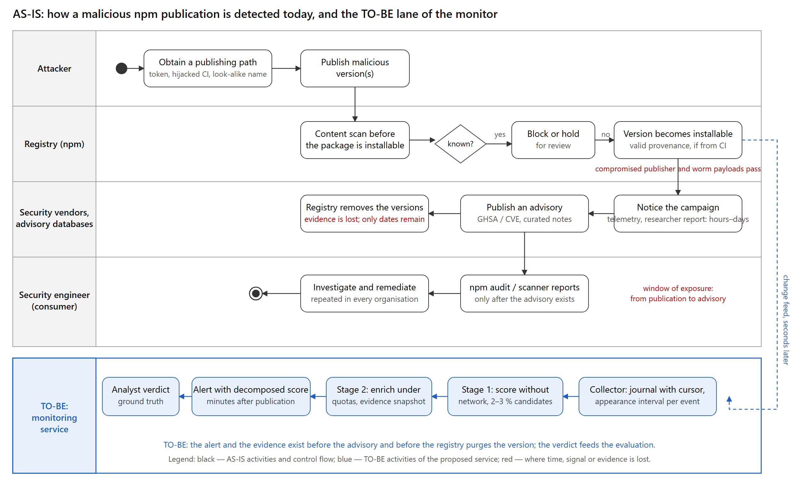
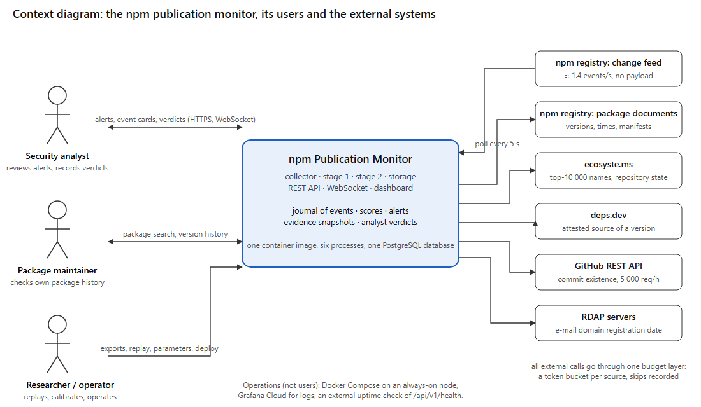
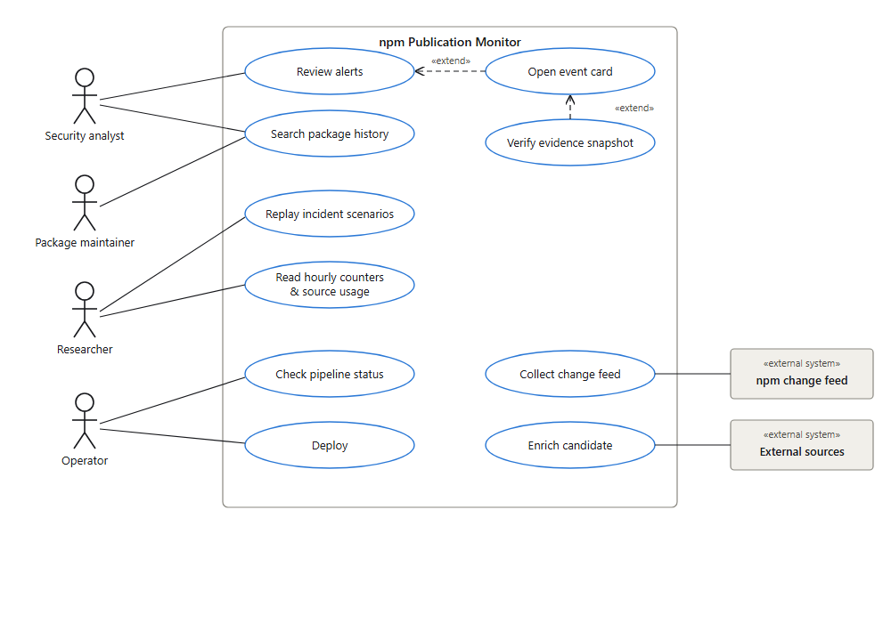
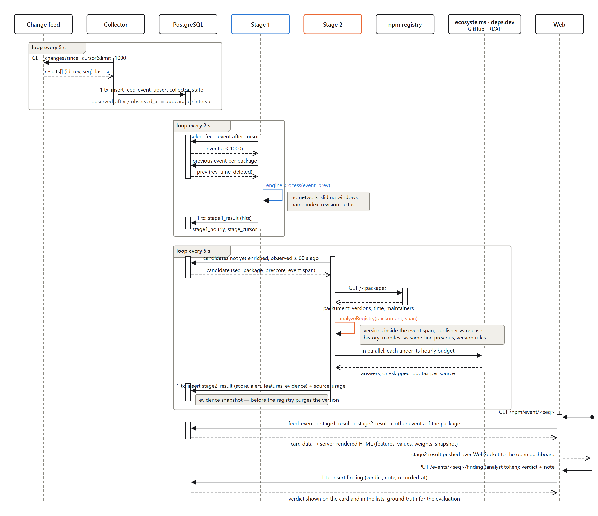
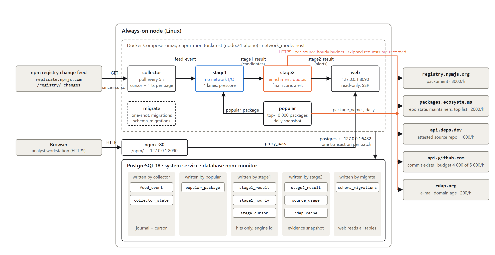

# Appendix B. Diagrams

All diagrams at readable size. Reduced copies appear in the text where they are discussed.

**Figure B.1 — AS-IS process of detecting a malicious npm publication, with the TO-BE lane of the monitor (UML activity diagram, Section 1.1)**

**Figure B.2 — Context diagram: users, the system and external systems (Section 2.4)**

**Figure B.3 — Use case diagram: actors and the use cases of Sections 2.5 and 2.6**

**Figure B.4 — System sequence diagram of UC1: from a registry publication to the analyst's verdict (Section 2.6)**

**Figure B.5 — Component diagram of the solution concept: six processes around one database (Section 2.4)**

