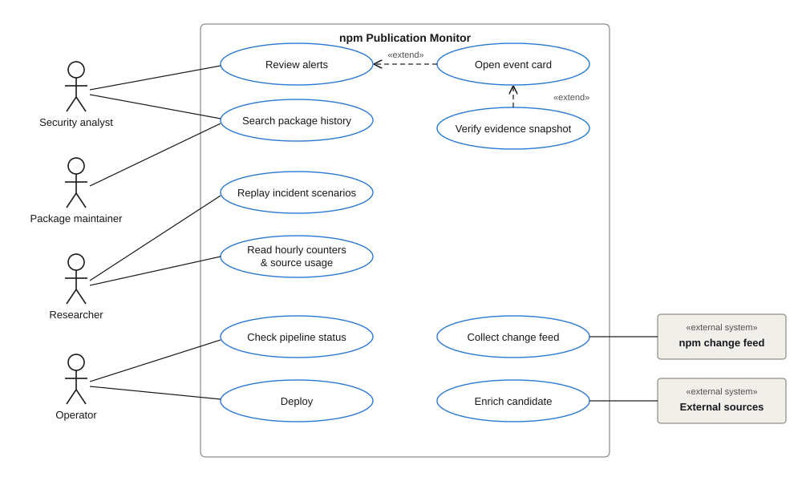

# Features and requirements

## Proposed solution

A pipeline of small processes around one PostgreSQL database: collector → journal → stage 1 → candidates → stage 2 → results and alerts → REST API and WebSocket → single-page dashboard. External systems: the npm change feed on the input side; the registry, ecosyste.ms, deps.dev, GitHub and RDAP on the enrichment side (diagrams in Chapter 2).

## Epics, priorities and user stories

Table: Epics with MoSCoW priority and user stories

| Epic | Priority | User stories (as a … I want …) |
|---|---|---|
| E1 Durable collection | Must | US1.1 resume from the cursor after a restart; US1.2 each event stored with its appearance interval |
| E2 Cheap filtering | Must | US2.1 a burst on a quiet package flagged within a minute; US2.2 look-alike names flagged; US2.3 every top-1000 publication checked; US2.4 deterministic stage 1 |
| E3 Enrichment | Must | US3.1 publisher vs. release history; US3.2 scripts, size, dependencies, repository vs. the previous version; US3.3 hourly budget per source, skips recorded; US3.4 evidence stored at enrichment |
| E4 Explainable alerts | Must | US4.1 every feature with value, threshold, weight; US4.2 alert at the threshold; US4.3 analyst verdict as ground truth |
| E5 Dashboard and API | Must | US5.1 health and lag of every process; US5.2 live feed smooth with tens of thousands of rows; US5.3 filters by package, feature, candidate, alert; US5.4 hourly statistics with charts; US5.5 documented REST API; US5.7 alerts on my dependencies only |
| E6 Adaptive UI | Should | US6.1 feed and card usable at 390 px |
| E7 Operations | Should | US7.1 alert when the collector stops; US7.2 logs in one place; US7.3 retention and exclusion on schedule |
| E8 Evaluation | Must | US8.1 inject incident scenarios into the background; US8.2 recall, precision, delay, request reduction |
| E9 Calibration | Could | US9.1 per-feature distributions set thresholds to a candidate budget |

## Use case diagram

Fig. 1.1: the analyst reviews alerts, opens cards, verifies evidence and records verdicts; the maintainer searches their package; the researcher replays scenarios and reads counters; the operator checks status and deploys.

## Feature status

Epics E1–E6, E8 and E9 are implemented. Of E7, the health endpoint and retention are; external alerting and central logs are prepared, not enabled. The replay (E8) is reported in Chapter 4; calibration (E9) ran on 64 h, five days and nine days of background.
