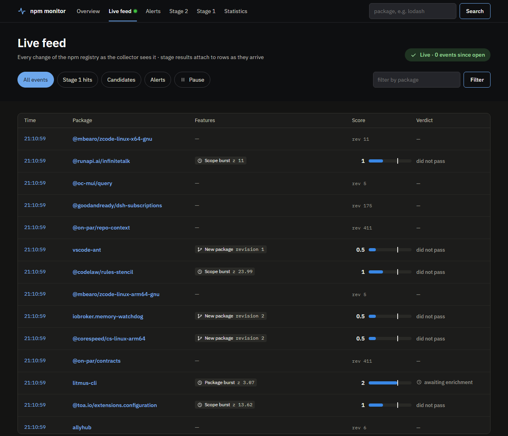

# Criterion 2 — Front-end

## Context

An analyst wants the stream now — a live feed and a card that explains a score; a researcher wants statistics over days. A page may stay open for a day, so the live list must stay smooth with tens of thousands of rows, with no build pipeline or CDN at runtime.

## Decision

A single-page application built with Preact 11 and htm — no JSX, no bundler; ES modules through an import map to vendored packages. The app uses the REST API of Criterion 7 and the WebSocket stream: on connect it receives `hello` with the newest `seq`, backfills with `GET /events?after=`, then applies `event`, `stage1`, `stage2` and `status` messages in place — a row's chips, score and verdict change where it stands; reconnection resumes from the last seen `seq`, so the stream has no gaps. The live feed is virtualised: fixed row height, only visible rows plus an overscan rendered, infinite scroll with `before=`, a banner buffering arrivals while the user is paused or scrolled away.

## Alternatives

| Alternative | Why rejected |
|---|---|
| Server-rendered pages (the first version) | no live or in-place updates; a 50 000-row feed cannot be a static table |
| React with a bundler | same model at ten times the dependency weight, plus a build step |

## Consequences

First paint is one HTML file, one stylesheet and ~25 KB of modules; no build, no transpilation drift. Virtualisation makes the feed O(visible rows) at the price of a fixed row height.

## Key decisions

- SPA over REST + WebSocket with a gap-free resume protocol.
- Virtualised live feed; pause and buffering instead of jumping rows.
- Preact + htm through an import map: zero build, strict CSP with the import map's hash.

## Structure

## Requirements compliance checklist

Table: Front-end criterion checklist

| Requirement | Status | Where |
|---|---|---|
| Single-page application | done | `app.js`, 9 view modules |
| Real-time feed over WebSocket | done | `ws.js`, resume from `last_seq` |
| List virtualisation | done | `virtual-list.js` + unit test |
| Package card with features and source data | done | `views/event.js` |
| Statistics page with charts | done | `views/stats.js`, `charts.js` |
| Filtering and search over events | done | filters, feature pills, package search |
