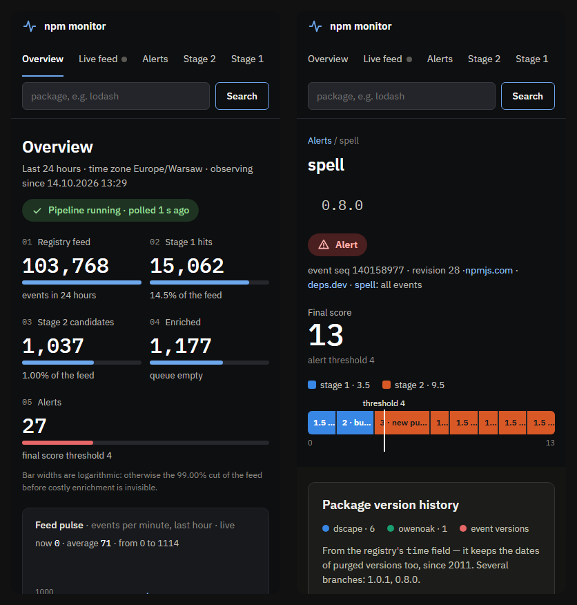

# Criterion 3 — Adaptive UI (web / mobile)

## Context

An analyst who receives an alert often opens it on a phone, and the two pages that matter there are the densest: a feed row carries time, package, chips, a score meter and a verdict; a card a score bar, a timeline and three tables. Desktop readers want the same pages at 1 280 px side by side.

## Decision

One responsive layout driven by CSS custom properties and media queries, no separate mobile build. Below 760 px the header stacks, the navigation scrolls horizontally, the funnel goes two per row, tiles and version blocks stack, and every table scrolls inside its own panel. Feed rows collapse to two lines while keeping the fixed height the virtualised list needs. The version timeline keeps a 760 px minimum width inside a scroll container. Touch targets are at least 44 px; every control is a real `button`, `a` or `input` with a visible focus ring. Colour follows the operating system with a separately chosen dark palette; alert states never rely on colour alone.

## Alternatives

| Alternative | Why rejected |
|---|---|
| A separate mobile app or sub-site | two code bases for a read-mostly dashboard |
| A CSS framework | the design system is ten custom properties and two palettes |
| Hiding columns on mobile | the chips and the score are the information; rows wrap instead |

## Consequences

The phone layout was checked at 390 px on four pages; three defects found that way were fixed before release.

## Key decisions

- One layout, media queries at 760 px and 480 px, no device detection.
- Tables scroll inside panels; the page never scrolls horizontally.
- Feed rows keep a fixed height on every width so virtualisation stays exact.

## Structure

## Requirements compliance checklist

Table: Adaptive UI criterion checklist

| Requirement | Status | Where |
|---|---|---|
| Responsive layout for desktop and mobile | done | media queries ≤ 760 / ≤ 480 px |
| Live feed fully functional on a phone | done | two-line rows, filters, pause, infinite scroll |
| Event card fully functional on a phone | done | stacked blocks, scrollable timeline, verdict control |
| No horizontal page scroll | done | overflow scoped to panels |
| Touch targets ≥ 44 px | done | buttons, pills, navigation |
| Accessibility basics | done | semantic elements, `aria-*`, focus ring |
