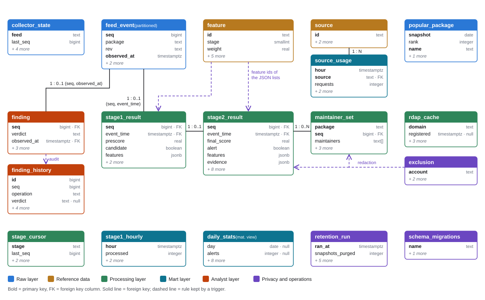

# Criterion 4 — Database

## Context

The seven processes share only the database. It keeps ≈ 99 000 registry events a day — the journal is the work queue and the background of the evaluation — and stage results, evidence snapshots with personal data, maintainer history and verdicts. Cursors must advance atomically with their data.

## Decision

PostgreSQL 18, 17 tables in three layers (Fig. 2.5): raw journal, stage results, counters. The journal `feed_event` is range-partitioned by month. Every unit of work — a page with the feed position, a batch with the stage cursor — is one transaction: exactly-once processing without a broker. Integrity is declarative: 5 foreign keys, 30 CHECK constraints, 6 triggers. The database itself enforces partition creation, the audit trail of verdicts, e-mail minimisation, the exclusion list and retention. Three roles (pipeline, dashboard, reports); none is a superuser.

## Alternatives

| Alternative | Why rejected |
|---|---|
| Unpartitioned journal | partitions bound index size; a time filter reads one or two |
| Column store for statistics | the largest report takes 5 s and is materialised |
| Document store for snapshots | JSONB keeps the snapshot in the transaction of its score |

## Consequences

A foreign key into the partitioned journal must contain the partition column, so result rows copy the event time; the key proves the copy. Snapshots without an alert are emptied after 30 days. The migrations were rehearsed on a production copy: 91 s for 3.17 million events.

## Key decisions

- Monthly partitions, created by an owner-rights function.
- Cursor and results in one transaction per batch.
- Personal-data rules in triggers.

## Storage strategy

Table: Measured growth after 32 days

| Table | Rows / day | Size / month | Retention |
|---|---|---|---|
| `feed_event` | ≈ 99 000 | ≈ 0.65 GB | whole period |
| `stage2_result` | ≈ 2 400 | ≈ 0.55 GB | snapshots: 30 days |

## Requirements compliance checklist

Table: Database criterion checklist

| Requirement | Status | Where |
|---|---|---|
| Event stream, partitioned by time | done | `001`, `004` |
| Snapshots, maintainer history, verdicts | done | `003`, `005` |
| Keys, constraints, 3NF, JSON model | done | `006` |
| Functions, triggers, views, indexes | done | `007`, `008` |
| Roles, masking, retention | done | `010` |
| Data dictionary, DDL, test data, 38 tests | done | `documentation/database/` |
