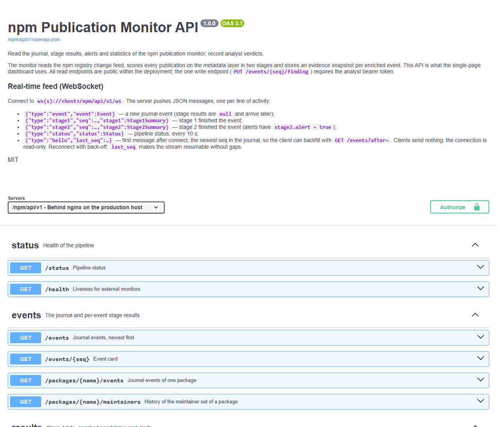

# Criterion 7 — API documentation

## Context

The dashboard and the evaluation scripts both read the server through HTTP and a WebSocket; they need a contract stating every path, parameter, response shape and error code that cannot drift from the implementation.

## Decision

The API is described first as an OpenAPI 3.1 document (`src/api/openapi.ts`), then implemented against it. The document is a TypeScript object, so it is type-checked, served verbatim at `/npm/api/v1/openapi.json` and rendered by Swagger UI at `/npm/api/docs` from the vendored `swagger-ui-dist`. It describes 16 operations in five tags, 18 schemas, cursor pagination (`before` / `after` / `limit` with `next_before`), the bearer scheme for the one write endpoint and every error response. The WebSocket stream is documented in `info.description`. A unit test asserts that every operation has an `operationId` and that every `$ref` resolves.

## Alternatives

| Alternative | Why rejected |
|---|---|
| OpenAPI generated from annotations | needs a framework; the contract would follow the code |
| Markdown reference | not machine-readable; Swagger UI gives "try it out" against the live server |
| GraphQL | a handful of list and detail queries map directly onto REST with cursors |

## Consequences

Client and server were built in parallel from the same file and integrated without renegotiation. Swagger UI doubles as a manual testing tool and the demo of the API.

## Key decisions

- Contract first: the OpenAPI object is the single source of truth, served unchanged.
- Cursor pagination instead of offsets — stable under a feed that grows every second.
- One write endpoint with bearer auth; everything else read-only.

## Structure

Table: API operations by tag

| Tag | Operations |
|---|---|
| status | `GET /status`, `GET /health` |
| events | `GET /events`, `GET /events/{seq}`, `GET /packages/{name}/events`, `/maintainers` |
| findings | `PUT` / `DELETE /events/{seq}/finding`, `GET /findings` |
| results | `POST /alerts/query` (alerts on a list of packages) |
| stats | `GET /stats/totals`, `/hourly`, `/pulse`, `/features`, `/sources`, `GET /features` |
| — | `GET /openapi.json`, Swagger UI, WebSocket `/api/v1/ws` |

## Requirements compliance checklist

Table: API documentation criterion checklist

| Requirement | Status | Where |
|---|---|---|
| OpenAPI 3.1 specification | done | `openapi.ts`, `/api/v1/openapi.json` |
| Interactive documentation (Swagger UI) | done | `/api/docs`, vendored |
| Data models, response codes, examples | done | 18 schemas; 200/204/400/401/404/405/413/503 |
| Real-time channel documented | done | WebSocket protocol in `info.description` |
| Spec validated automatically | done | `test/api.test.ts` |
