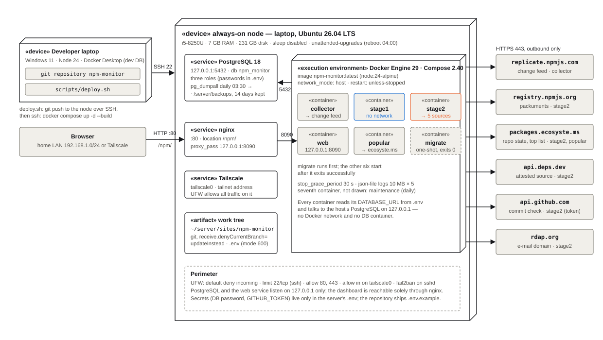

# Deployment



Fig. 2.7 shows the topology: one always-on Ubuntu 26.04 node (7 GB RAM, 230 GB disk) with PostgreSQL 18 and nginx as system services and the application as one Docker image started as seven Compose services in the host network, `web` on `127.0.0.1:8090`.

## Delivery pipeline

Delivery is a push-to-deploy flow of about 40 seconds: `npm run typecheck` and `npm test` locally, then `scripts/deploy.sh` pushes `main` over SSH into the server's work tree (`receive.denyCurrentBranch = updateInstead`) and runs `docker compose up -d --build --remove-orphans` there: the image is rebuilt, `migrate` applies new migrations, workers restart from their cursors. Secrets never leave the server (`.env`, mode 600).

## Running the project

```sh
cp .env.example .env                 # DATABASE_URL, GITHUB_TOKEN, ANALYST_TOKEN
docker compose up -d --build         # production, PostgreSQL 18 on the host
docker compose -f docker-compose.yml -f deploy/compose.logs.yml up -d   # with log shipping
```

For local development, `compose.dev.yml` starts PostgreSQL 18 on `127.0.0.1:55432` and each worker runs as a separate `npm run` script.

The dashboard is exposed by including `deploy/nginx-npm-monitor.conf` into the nginx site or by an SSH tunnel to port 8090. Automatic reboots are off: the disk is encrypted, so a reboot waits for a passphrase (the outage of 5 November). All processes use under 250 MB of memory and under 1 % CPU; the database grows by ≈ 1.2 GB a month.
