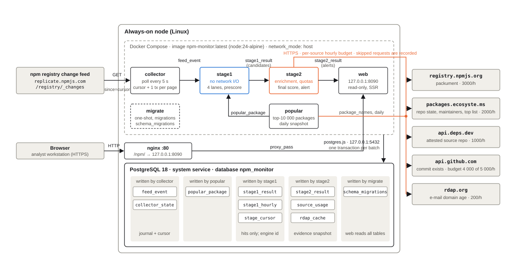
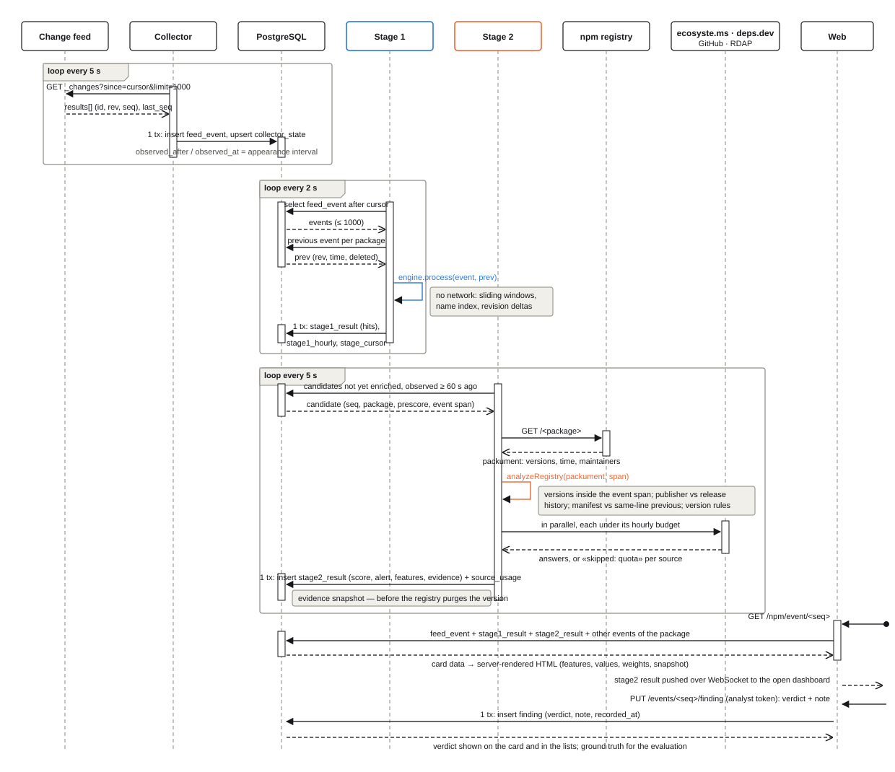

# 2. Technical Implementation

## Architecture

The system is a pipeline of seven processes built from one container image and sharing one PostgreSQL database (Fig. 2.1). Every process is a single Node.js file, restartable at any moment; every stage advances its cursor in the same transaction as its results, so a crash can neither lose nor double-process an event.

Table: Components and what they write

| Component | Responsibility | Writes |
|---|---|---|
| Collector | polls the change feed from the saved cursor, stores events with their appearance interval, maintains monthly partitions | `feed_event`, `collector_state` |
| Popular snapshot | fetches the top-10 000 names by downloads once a day | `popular_package` |
| Stage 1 | temporal, nominal, version and watchlist features with no network requests; stores only hits | `stage1_result`, `stage1_hourly`, `stage_cursor` |
| Stage 2 | enriches candidates under source budgets; final score, alert flag, evidence, maintainer history | `stage2_result`, `maintainer_set`, `source_usage`, `rdap_cache` |
| Web | REST API, WebSocket stream fed by `NOTIFY`, Swagger UI, static SPA | `finding` |
| Maintenance | once a day: partitions ahead, retention periods, daily statistics | `daily_stats`, `retention_run` |
| Migrate | applies `migrations/*.sql` in order, one transaction each | `schema_migrations` |

## Event flow

Fig. 2.2 follows one event. The collector stores a page of changes (`seq`, package, revision) with the new cursor in one transaction; each event gets the interval `(observed_after, observed_at]` in which it can have appeared — ≈ 5 s in normal polling, the whole outage after downtime. Stage 1 prefetches the previous journal event of every package in a batch and runs the deterministic engine. Stage 2 attributes to the event the versions published between the package's previous event and the observation time (5 minutes of feed lag allowed); the registry analysis is a pure function over the packument, external sources are queried in parallel within budgets. Every commit sends a `NOTIFY`, relayed to browsers.

## Scoring

The score is a weighted sum of triggered features, not a trained model: there is no labelled corpus and every verdict must be checkable by hand. Provenance is recorded but has no weight: the reference incidents carried valid attestations. A candidate is any event at preliminary ≥ 2 or on the watchlist; an alert needs final ≥ 4 (not for the watchlist), stage-2 features weighing at least 2 (removed versions excluded), a package still present in the registry, and no earlier alert for the package within six hours. Comparisons use as baseline the package as it was ten minutes before the event's first version. The node-ipc scenario scores 8.5: package burst 2 + new publisher 3 + non-adjacent branches 2 + dormant release 1.5.
