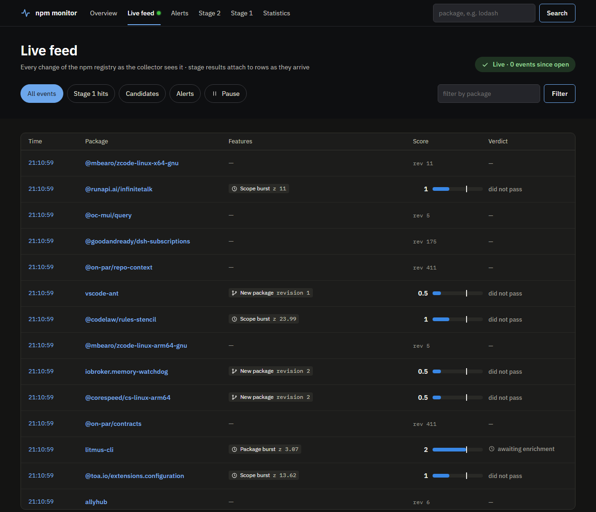
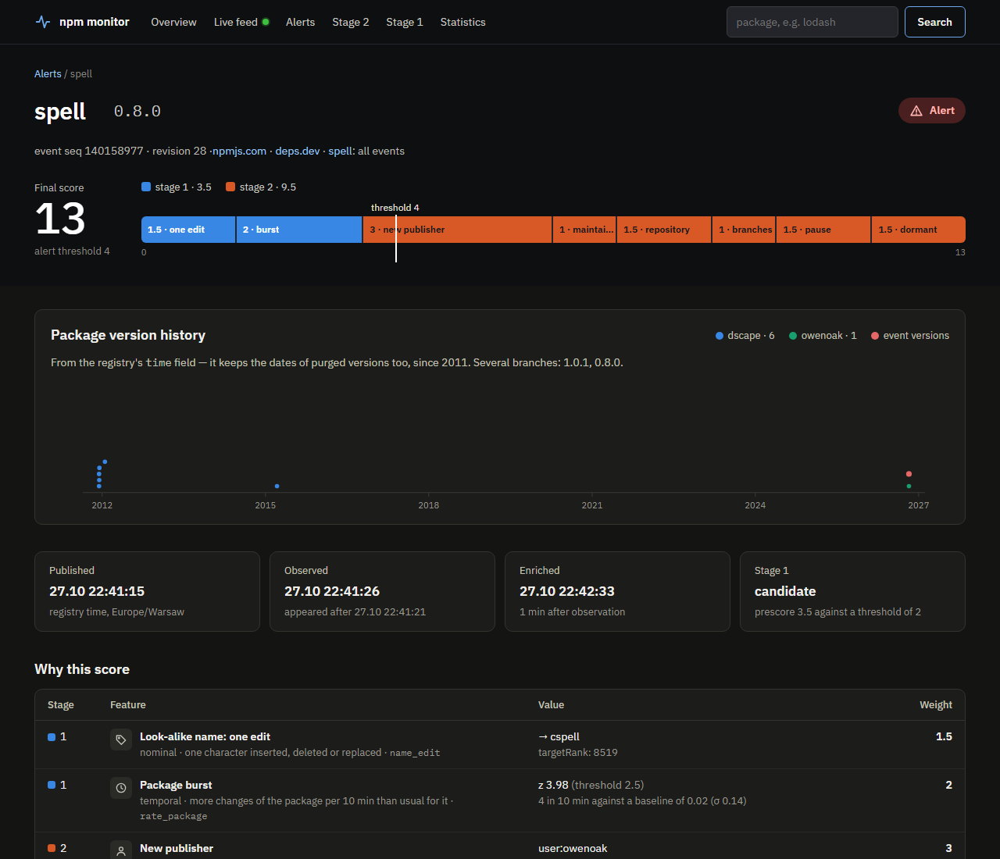
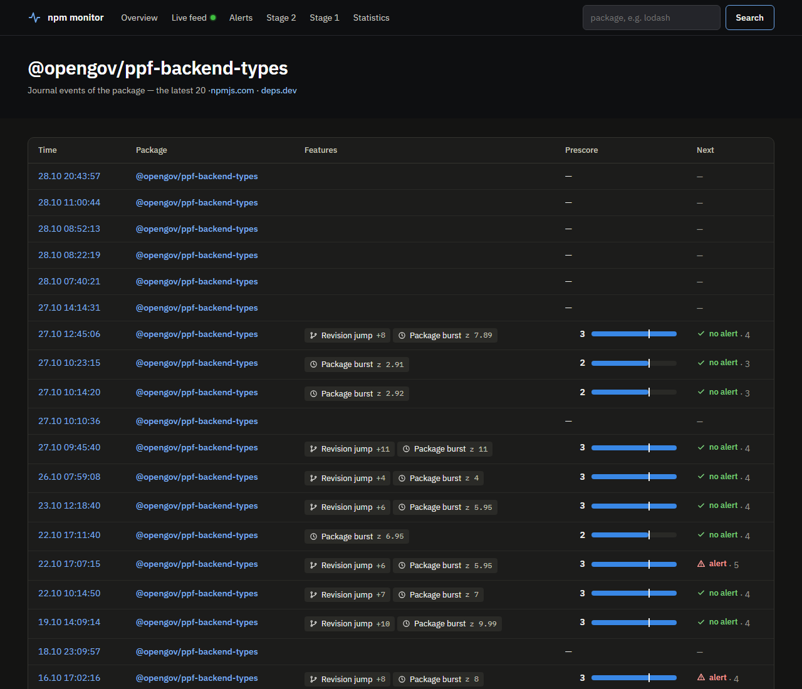
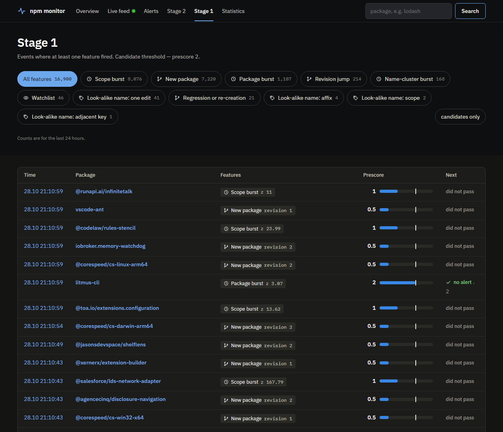
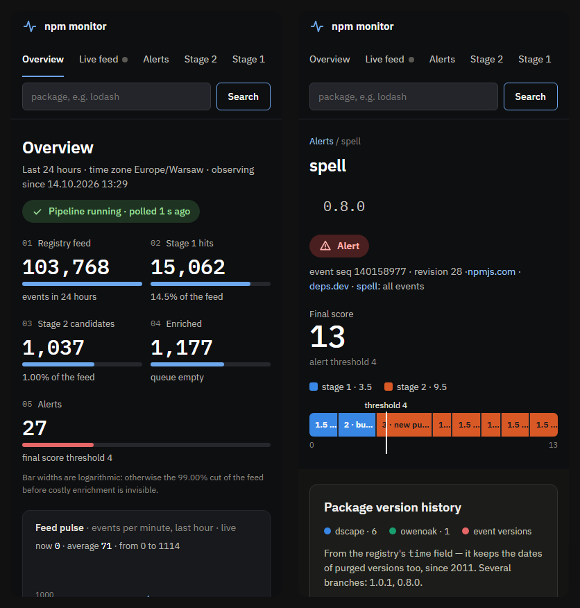

# Features step by step

## Watching the live feed

1. Open **Live feed**. New events appear on top as the registry publishes them; the list is virtualised and stays smooth after hours of use (Fig. 3.2).
2. When a stage finishes an event, its row updates in place: chips, score meter and verdict appear without reloading.
3. Use the pills to see only flagged events, candidates or alerts, or type a package name to follow one.
4. Scroll down to load older events; scroll away from the top or press **Pause** and arrivals are buffered; a banner "N new events" brings you back.

## Reviewing an alert

1. Open **Alerts** and click the time of a row (Fig. 3.3).
2. The dark band shows the verdict, the final score and its composition: blue segments are stage-1 features, orange are stage-2, the white line is the threshold.
3. **Package version history** draws every version on a time axis: dots coloured by publisher, hollow dots for versions the registry has purged, red dots for this event; a bracket marks a long silence.
4. **Why this score** lists each feature with its lane, explanation, measured value, threshold and weight.
5. **Publication** compares the version with the previous one of the same line.
6. **Sources** states what each source answered or that a request was skipped for quota.
7. Record your verdict — *Confirmed*, *False positive* or *Undecided* — with a note and a reference; the first time, the page asks for the analyst token.

## Checking your own package

Type the name into the search box. The package page lists every journal event with chips, scores and verdicts, and the maintainer-set history below (Fig. 3.4).

## Understanding what stage 1 flags

Open **Stage 1**. The pills filter by feature and show the count for 24 hours; the chip in each row carries the measured value (Fig. 3.5).

## My dependencies

Paste a lock file or a list of names: the page shows only the alerts on these packages and their count per day for 14 days. The list stays in the browser.

## On a phone

Every page works at phone width (Fig. 3.6): the navigation scrolls sideways, feed rows collapse to two lines, tables scroll inside their panels.

