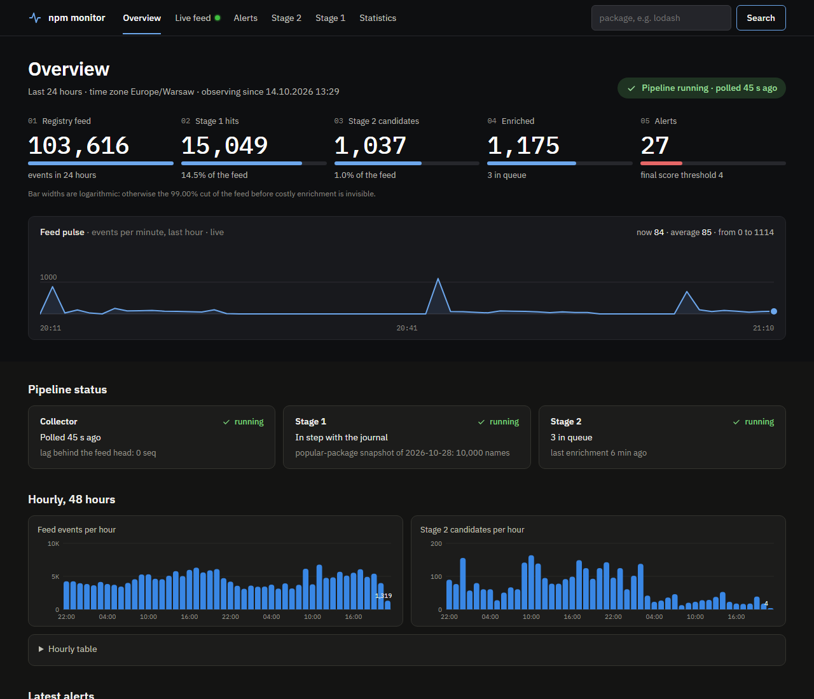

# 3. User Guide

## Getting started

The dashboard is a single-page web application; nothing to install, no account. Open `/npm/` on the monitoring node from its private network in any current browser, including a phone. The page connects to the server's WebSocket stream, so the live parts update without reloading; a green dot next to *Live feed* shows that the stream is connected (Fig. 3.1).

Table: Pages of the dashboard

| Page | What it shows |
|---|---|
| Overview | the funnel from feed events to alerts (24 h), the live pulse, the health of the collector and both stages, hourly charts (48 h), feature hits, source requests, the latest alerts and enriched events |
| Live feed | every journal event as it arrives; filters all / flagged / candidates / alerts, package filter, pause |
| Alerts, Stage 2 | enriched candidates with final score, verdict and feature chips |
| Stage 1 | events with at least one stage-1 feature, filterable by feature |
| Statistics | hourly charts, feature hits and source requests for 24 h to 30 d |
| Search | all journal events of one package and its maintainer-set history |

Clicking a time anywhere opens the event card: why the event got its score, the publication against the previous version, the version history, the sources' answers, the analyst verdict and the evidence snapshot.

## Reading a score

The preliminary score is the sum of stage-1 feature weights; an event becomes a candidate at ≥ 2, or at any score if the package is on the top-1000 watchlist. The final score adds the stage-2 weights; an alert is raised at ≥ 4 — at any score for a watchlist package — when stage-2 features contribute at least 2 and the package is still in the registry, and only once per package in six hours. Bars use a fixed scale (0–3 for stage 1, 0–10 for stage 2) with a black tick at the threshold; red marks alerts only, always with an icon. Times are in the server's zone (`Europe/Warsaw`); an event has no timestamp of its own, so the card shows its observation time and the bound after which it appeared.
